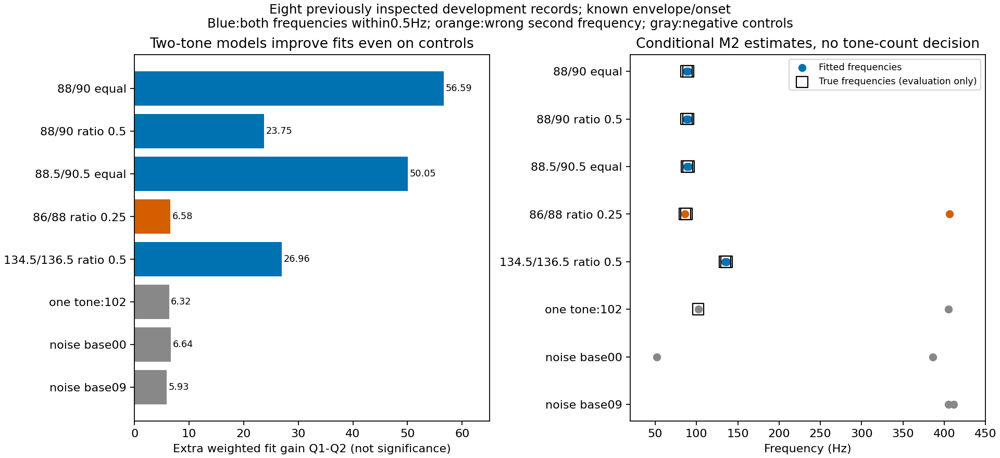
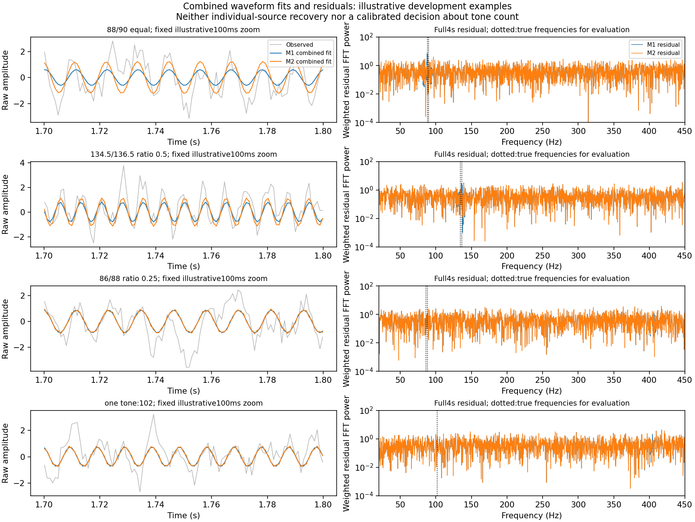

# Known-envelope waveform-model smoke study —28 November2026

## What was tested

Eight already inspected development records from matched_gap2/20261128T115035Z_bf957291 were fitted as noise (M0),one sinusoid (M1),or two sinusoids (M2),plus a shared constant. Each record is4s at1024Hz. All models know the experimental one-second Tukey envelope and onset1.25s;frequencies20..450Hz,amplitudes and phases are unknown. No true carrier frequency enters the fitting routine. Labels were attached afterward. This is a conditional implementation probe,not a blind transient search,independent performance estimate or source-separation experiment.

A common stationary-noise weighting was estimated from284 separately generated historical calibration records,each verified against its original hash. Target and model columns use identical weights. Fixed-frequency coefficients are fitted jointly;continuous frequencies use multiple local starts. The frozen protocol and full driver are archived here. The objective is circulant weighted residual energy,not an exact likelihood or calibrated significance.

## Observations

| Known input | M1 frequency (Hz) | M2 frequencies (Hz) | M2 errors (Hz) | Q1-Q2 | Both within0.5Hz? |
|---|---:|---|---|---:|---|
| 88/90 equal | 90.1720 | 87.9507 / 90.0131 | 0.0493 / 0.0131 | 56.5911 | True |
| 88/90 ratio 0.5 | 87.8694 | 87.9611 / 90.0153 | 0.0389 / 0.0153 | 23.7505 | True |
| 88.5/90.5 equal | 90.6612 | 88.4117 / 90.5302 | 0.0883 / 0.0302 | 50.0453 | True |
| 86/88 ratio 0.25 | 85.9302 | 85.9302 / 406.3008 | 0.0698 / 318.3008 | 6.5764 | False |
| 134.5/136.5 ratio 0.5 | 134.3825 | 134.4525 / 136.5526 | 0.0475 / 0.0526 | 26.9573 | True |
| one tone:102 | 102.0563 | 102.0563 / 404.9783 | not applicable | 6.3247 | no tone-count decision |
| noise base00 | 51.6441 | 51.6441 / 386.1352 | not applicable | 6.6428 | no tone-count decision |
| noise base09 | 404.9783 | 404.9273 / 411.5292 | not applicable | 5.9303 | no tone-count decision |

Four of five two-tone examples have both fitted frequencies within0.1Hz of truth (the predeclared success tolerance is0.5Hz). In particular,the earlier erroneous134/139Hz claim becomes134.4525/136.5526Hz,near134.5/136.5Hz. Separate visible spectral maxima are therefore not necessary for frequency estimation in these known-envelope examples. This does not establish independent improvement or a universal resolution limit.

The86/88Hz weak-component example still fails:85.9302/406.3008Hz. The optimizer selected a distant nuisance component,not the88Hz tone. Numerical convergence does not establish that this is the global optimum,or distinguish a noise-driven optimum from missed initialization basins. We did not add truth-guided starts or retune after observing it.

M2 also improves the one-tone fit by6.3247 and the two noise fits by6.6428/5.9303. The failed two-tone example has gain6.5764,within that tiny control range. These three controls cannot define a threshold or false-positive rate. No number-of-tones decision was made,and no false-two-tone claim rate can yet be measured. M2 nuisance estimates on controls are retained explicitly,not presented as discoveries. Do not choose an apparent gap in these eight gains as a new decision rule.

## Numerical checks and runtime

All143local-start optimizations report convergence. Selected design condition numbers are1.00..2.70,below the declared1e8warning level. There were no interrupted fits or replaced examples. Independent reconstruction checked16model predictions/residual energies/normal equations,all143returned-start objectives,284background hashes and the PSD/weight calculation. Maximum relative normal-equation residual:1.74e-14. All529parent artifacts and19production source files retain their hashes. Four fixed-design fixture assertions also pass. These are numerical checks,not scientific validation.

Background generation/PSD:1.432s;grid precomputation:0.535s;complete driver:14.116s. Per-record M1+M2:1.124..1.338s,single-thread numerical environment. Host/library versions and per-model timings are in manifest/results. This is no benchmark against BSD.

## Limits and next decision

The known envelope/onset gives this method substantial information. Timing error and unknown boundary localization are not estimated:the model support is fixed by design. Stationary tones with that exact envelope are much easier than arbitrary transients,audio mixtures or changing real-sensor noise. The five two-tone cases include shared-noise examples,so4/5 is only a descriptive count,not independent binomial performance. The single/noise set is especially small.

The next useful stage is independently calibrated model selection,then untouched evaluation noise/single/two-tone inputs across amplitude,phase,spacing and envelope/onset mismatch. Keep tone-count accuracy and frequency accuracy separate. Multi-start convergence needs further stress controls. No production adoption is justified here. No BSD detector mathematics,app,historical results,O3,commit,push,release or Zenodo operation was performed.

## Files

- results.json:all model costs,coefficients,frequencies,truth evaluation,starts,statuses,timing.
- Eight NPZ files:original waveform,combined predictions and raw residuals (local artifacts;not individual source waveforms).
- background_weights.npz / background_hashes.json:independent weighting evidence.
- fixtures.json / verification.json:numerical checks and scope.
- waveform_smoke_summary.png and waveform_fit_and_residual_comparisons.png:descriptive plots.

Run: `results/waveform_model_smoke/20261128T153849Z_f9604231`.

