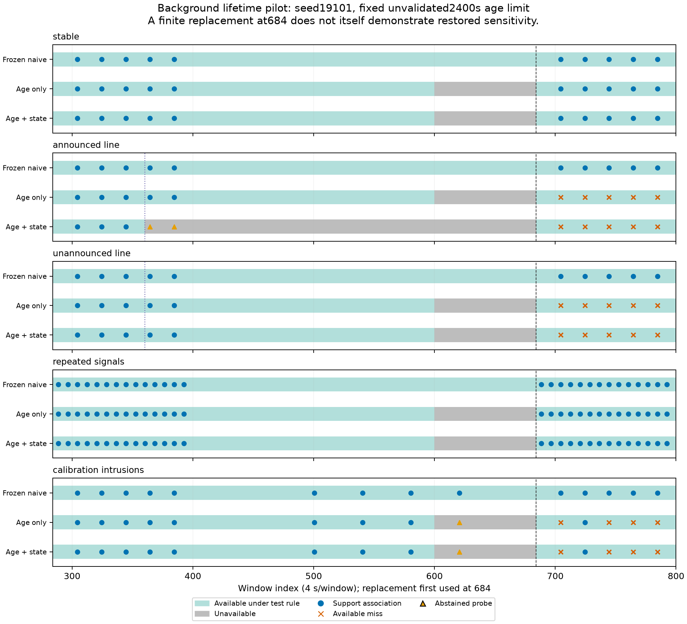
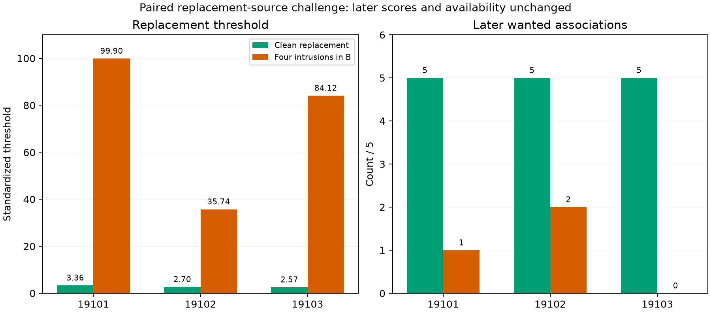

# Background lifetime and reacquisition: causal timeline pilot

Run `20261127T170612Z_189c239c`, source e21a7cc. [Prespecified protocol](protocol.md), [independent checks](independent_verification.json), [paired contamination check](paired_contamination_verification.json), [counts](summary_counts.csv).

## Design and information available to the controller

Three continuous FFT-shaped pink traces,800four-second windows each; five paired cases per seed and three fixed policies. One seed is the replication unit. This is a synthetic bench profile: planned background acquisition0..283/400..683, external deliberate source OFF during those periods, and an explicit unknown-intrusion exception. An OFF command is not proof that every possible signal is absent. The controller uses only acquisition timing and observed instrument-state metadata, never truth labels or detector scores for admission.

Dedicated FAP0.005, normalization fraction0.30:85A/199B,284source windows. Initial fit through283 first used284; replacement fit after683 first used684. The age rule checks complete window end against oldest source start+2400s, equality allowed. This2400s setting is a frozen UNVALIDATED parameter, not a recommended lifetime. It expires at600; age-only is unavailable600..683. Announced state change at360 makes state+age unavailable360..683. Unannounced change leaves telemetry unchanged; the two updating policies must then be identical.

Noise is generated as one jointly colored sequence with a periodic FFT boundary, notIIDwindows. Algorithms operate on individual four-second observations; statistical correlation and finite-sample calibration variability remain. The simulator generates the full input offline and raw-cache parity checks include a future subset, but neither future measurements nor labels enter fitted parameters/eligibility. This is causal source/use semantics under replay, not a live throughput validation.

## Descriptive results

Available-exposure denominators differ. Fewer alarms during abstention are not evidence of better sensitivity or equal achievedFAR. Associations are accepted-candidate overlap with known support, not physical waveform identification. No confidence/superiority/adoption inference is made from three paired seeds. Read late associations beside noise alarms.

| Case | Policy | Noise alarms / available noise windows | Available target windows | Wanted associations / probes | Wanted abstentions | Late wanted associations |
| --- | --- | ---: | ---: | ---: | ---: | ---: |
| stable | frozen_naive | 4/1518 | 1548/1548 | 29/30 | 0 | 14/15 |
| stable | age_only | 7/1266 | 1296/1548 | 30/30 | 0 | 15/15 |
| stable | age_and_state | 7/1266 | 1296/1548 | 30/30 | 0 | 15/15 |
| announced_line | frozen_naive | 1299/1518 | 1548/1548 | 30/30 | 0 | 15/15 |
| announced_line | age_only | 717/1266 | 1296/1548 | 15/30 | 0 | 0/15 |
| announced_line | age_and_state | 3/552 | 576/1548 | 9/30 | 6 | 0/15 |
| unannounced_line | frozen_naive | 1299/1518 | 1548/1548 | 30/30 | 0 | 15/15 |
| unannounced_line | age_only | 717/1266 | 1296/1548 | 15/30 | 0 | 0/15 |
| unannounced_line | age_and_state | 717/1266 | 1296/1548 | 15/30 | 0 | 0/15 |
| repeated_signals | frozen_naive | 3/1464 | 1548/1548 | 82/84 | 0 | 42/42 |
| repeated_signals | age_only | 6/1212 | 1296/1548 | 82/84 | 0 | 42/42 |
| repeated_signals | age_and_state | 6/1212 | 1296/1548 | 82/84 | 0 | 42/42 |
| calibration_intrusions | frozen_naive | 4/1506 | 1548/1548 | 29/30 | 0 | 14/15 |
| calibration_intrusions | age_only | 2/1257 | 1296/1548 | 18/30 | 0 | 3/15 |
| calibration_intrusions | age_and_state | 2/1257 | 1296/1548 | 18/30 | 0 | 3/15 |

## What the pilot establishes

1. A clock is not a change detector. The unannounced line starts360, while the fixed age policy keeps using the old background through599. It accumulates noise alarms before expiry; scheduling later replacement does not prevent this unsupported interval. The paired announced/unannounced waveforms and core measurements are identical. Different state+age behavior is caused only by observable telemetry, not hidden waveform truth.

2. State qualification has a measurable coverage cost. After the announced change, eligibility returns684 only after waiting40windows for the planned acquisition plus284windows to collect it:324windows/1296s (21.6min). The age-only gap is84windows/336s. At4s/window, the284-window acquisition itself lasts1136s (18min56s). The run validates this bookkeeping, not a universal latency or practical viability for a real application.

3. A new finite calibration is not recovered sensitivity. In the line cases, the replacement becomes available684 but late wanted associations remain poor/absent. Frozen-naive can mark positive windows simply because it nominates the line on nearly every noise window. Do not describe its apparent10/10recovery as physical identification.

4. Scheduled expiry costs coverage even in stable noise:84target windows per seed are unavailable, although the synthetic noise law never changed. This is a cost of the chosen unvalidated policy, not proof that any old background is always safe. Repeated wanted signals do not trigger score-based expiry or enter the commanded quiet source intervals; this does not establish general immunity to contamination.

5. The replacement can be contaminated despite an unchanged source-OFF command. Exactly fourBwindows differ between stable and intrusion cases. NormalizationA, all later scores, target inputs and eligibility are unchanged, but updated late wanted associations drop15/15->3/15. This isolates threshold contamination in the constructed paired case. Frozen initial late associations remain14/15inboth. The operator command is therefore an acquisition assumption, not a purity certificate.

The three clean->intruded replacement thresholds are3.357758->99.897055,2.699896->35.741650,and2.568230->84.123418. This is a planned stress case, not an estimated rate of real contamination. Do not trim the four known labels as a deployable fix.

## Verification, limitations and preserved evidence

Independent saved-record checks pass30calibrations,9480core measurements,23220policy records,33239candidate records and12000regenerated input-window records. 135direct uncached parity checks and23controller/ledger fixtures pass. 1734policy records retain nonempty diagnostic candidate references while official threshold/p are null. These are scoped checks, not pytest suite passes or scientific validity proof.

Calibration reconstruction includesAmedians/Q95/spreads,Bmaxima/rank,empiricalp/strictacceptance,candidate standardization/bounds/association,exacttiming/state/ageeligibility,source-before-use,freezehashes,exposure,eras and later probes. Announced/unannounced raw records/core outputs match exactly; stable/intrusion source changes onlyfourBwindows. All historical outputs remain untouched.

No production manager/Workstation was changed. The controller fixtures cover missing/invalid timing/state/readiness and rank insufficiency, but actual resource-capped reacquisition, within-window changes, uncertain-clock data and a drift-monitor/repeated-testing policy were NOT run. Union cannot attain its0.005FWER allocation with199B; no Union recovery is claimed. Real background purity, a calibrated age limit, long-horizonFAR, non-synthetic stationarity, live latency and astrophysical significance remain unverified.

No measurement errors, interrupted runs, dropped cases or retuning. A post-measurement plot-script preparation failed (undefined root, then missing plot file); the error is retained in presentation_preparation_error.json. Only presentation preparation was corrected; measurements and independent verification were not rerun. Source/dependency hashes unchanged; no O3/data/manifest/network or real waveform access. All inputs, calibrations, truth-only evaluation labels and failed outcomes are preserved. No automatic adoption, commit/push/release/Zenodo action.

Timeline shows the first prespecified seed19101; all seed counts remain above and inCSV. Grey periods are unavailability, not zero-noise success. Markers show diagnostic evaluation outcomes only. Frozen-naive blue markers in line cases coexist with433/433post-change noise nominations per seed; they are not evidence of physical signal recovery.

Paired thresholds and later support associations. All later scores/eligibility unchanged; noise control and source assumptions still require separate assessment.

## Next decision

Do not deploy this2400s setting as a freshness rule. A validated observable distribution-change warning is needed for unannounced changes, with protection against mistaking genuine persistent signals for noise and a declared monitoring horizon. Source acquisition also needs externally justified contamination controls; telemetry+age alone does not establish them. Specify one candidate monitor and an independent sequence-level validation before changing production, retaining abstention/latency and lost signals as coequal outcomes.
