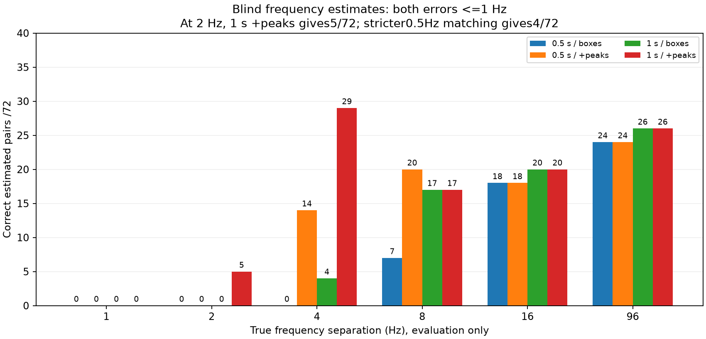
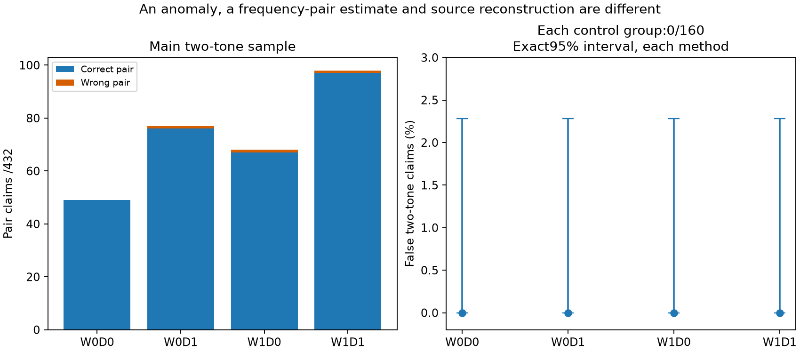

# Blind two-tone exploratory comparison

Run `20261127T192047Z_f279641e`. Source `cc68b93`. [Frozen protocol](protocol.md), [independent verification](independent_verification.json), [reproducibility checks](reproducibility_verification.json).

## Scope and frozen rules

Four research arms: W0=historical bank with 0.5 s longest window; W1=replace longest window with 1 s, keep 0.125 s hop and the other scales. D0=disjoint accepted longest-scale clusters with overlapping time boxes; D1=also search multiple peaks within one accepted longest-scale cluster. No production changes. The 1 s configuration changes frequency smoothing bandwidth as well as window duration; this is not an isolated duration ablation.

Truth-blind estimators receive only the observation and frozen calibration. D1 uses a cluster-selected mean spectrum, local maxima >=4, an interior-bin valley <=0.8 times the smaller peak, and no true-frequency neighborhoods. Proposals are ranked by the smaller peak height, exact duplicate frequency pairs deduplicated, equal estimates forbidden. At most one pair is returned. Correctness requires one-to-one matching with both errors <=1 Hz; the stricter gap/4 result is retained. Every claim on noise or a single tone is a false two-tone claim. No separate waveforms are reconstructed.

Independent streams: 284 anomaly-calibration noise observations,199 pair-calibration noise and199 pair-calibration single-tone observations. W configurations fitted separately, all four pair cutoffs frozen before held-out evaluation. In all four arms the chosen pair-null order statistic was missing-proposal (-infinity), serialized as null with explicit semantics. Thus any finite eligible proposal passes the pair cutoff; missing proposals never pass. This is an outcome of sparse null proposals, not unavailable calibration or a measured zero false rate. Stored null distributions and empirical p checks are retained.

No threshold/gate was changed after evaluation. One independent calibration draw per W; all arms share evaluation inputs for pairing. Historical 96/98 results were used for development and are not claimed as new held-out evidence.

## Main held-out results

432 two-tone observations:6 gaps x3 relative phases x3 amplitude ratios x2 grid offsets x2 onsets x2 resultant SNRs. Each full factorial cell has ONE independent noise/carrier draw; marginal counts mix other conditions and have limited precision. Additional160noise and160single-tone controls are independent. Two-tone resultant energy is matched at linear root-energy SNR8/18; components are not each SNR18 as in the historical study.

| Arm | Anomalies on two tones /432 | Pair claims | Correct <=1Hz | Correct gap/4 | Wrong pair | No pair |
| --- | ---: | ---: | ---: | ---: | ---: | ---: |
| W0D0 | 317 | 49 | 49 | 49 | 0 | 383 |
| W0D1 | 317 | 77 | 76 | 76 | 1 | 355 |
| W1D0 | 307 | 68 | 67 | 67 | 1 | 364 |
| W1D1 | 307 | 98 | 97 | 96 | 1 | 334 |

| Gap (Hz), n=72 each | W0D0 | W0D1 | W1D0 | W1D1 |
| --- | ---: | ---: | ---: | ---: |
| 1 | 0 | 0 | 0 | 0 |
| 2 | 0 | 0 | 0 | 5 |
| 4 | 0 | 14 | 4 | 29 |
| 8 | 7 | 20 | 17 | 17 |
| 16 | 18 | 18 | 20 | 20 |
| 96 | 24 | 24 | 26 | 26 |

The W1D1 gap2 result is5/72 at1Hz tolerance,4/72 at stricter0.5Hz tolerance. At gap1 no arm recovered a correct pair. Some methods return a wrong pair on a gap1 input; this does not constitute successful separation. All ambiguous matches and errors are retained.

| Arm | Noise anomalies /160 | Noise false pairs /160 | Single-tone anomalies /160 | Single-tone false pairs /160 |
| --- | ---: | ---: | ---: | ---: |
| W0D0 | 2 | 0 | 143 | 0 |
| W0D1 | 2 | 0 | 143 | 0 |
| W1D0 | 0 | 0 | 143 | 0 |
| W1D1 | 0 | 0 | 143 | 0 |

Zero false pair claims in160inputs has an exact two-sided95% upper bound of2.28% per method/population. It does not validate a1% false-pair bound conditionally on this calibration, or any real-data guarantee. Do not pool dependent arms to inflate the denominator. W0 also nominated2/160noise windows as anomalies; pair abstention does not erase those anomaly false alarms.

## Stratified results and failures

[stratified_counts.csv](stratified_counts.csv) reports counts separately by gap, ratio, relative phase, grid offset, onset and SNR. [factorial_cases.csv](factorial_cases.csv) retains each complete cell. Offset0 is on both grids; offset0.5Hz is off both (half the1Hz grid, quarter the2Hz grid). Actual frequency remainders are saved in evaluation metadata. [paired_discordances.csv](paired_discordances.csv) preserves wins/losses on identical observations, without a confirmatory multiple-comparison claim.

### Amplitude ratio

| Value (denominator) | W0D0 | W0D1 | W1D0 | W1D1 |
| --- | ---: | ---: | ---: | ---: |
| 0.25 (144) | 0 | 1 | 1 | 7 |
| 0.5 (144) | 20 | 25 | 25 | 35 |
| 1 (144) | 29 | 50 | 41 | 55 |

### Relative phase (radians)

| Value (denominator) | W0D0 | W0D1 | W1D0 | W1D1 |
| --- | ---: | ---: | ---: | ---: |
| 0 (144) | 17 | 26 | 23 | 33 |
| 1.5708 (144) | 15 | 26 | 21 | 32 |
| 3.14159 (144) | 17 | 24 | 23 | 32 |

### Base frequency-grid offset (Hz)

| Value (denominator) | W0D0 | W0D1 | W1D0 | W1D1 |
| --- | ---: | ---: | ---: | ---: |
| 0 (216) | 23 | 39 | 35 | 52 |
| 0.5 (216) | 26 | 37 | 32 | 45 |

### Onset (seconds)

| Value (denominator) | W0D0 | W0D1 | W1D0 | W1D1 |
| --- | ---: | ---: | ---: | ---: |
| 1.25 (216) | 25 | 38 | 34 | 49 |
| 1.31152 (216) | 24 | 38 | 33 | 48 |

### Resultant root-energy SNR

| Value (denominator) | W0D0 | W0D1 | W1D0 | W1D1 |
| --- | ---: | ---: | ---: | ---: |
| 8 (216) | 0 | 5 | 1 | 4 |
| 18 (216) | 49 | 71 | 66 | 93 |

Wrong frequency pairs (one example can fail in more than one arm):

- W0D1, input30701_0170: truth[126.0, 130.0], estimate[122.0, 126.0]; gap4.0, ratio1.0, SNR8.0.
- W1D0, input30701_0006: truth[156.5, 157.5], estimate[157.0, 398.0]; gap1.0, ratio1.0, SNR8.0.
- W1D1, input30701_0006: truth[156.5, 157.5], estimate[157.0, 398.0]; gap1.0, ratio1.0, SNR8.0.

## Timing and record boundaries

Main onsets compare exact hop alignment1.25s with1.3115234375s, about half a hop later. Signals span many overlapping windows. Boundary/offset rows above retain lost cases. Correct-pair timing uses the union of contributing component boxes and mean component peak time, compared with envelope support and its midpoint; midpoint is not a true physical intensity peak. The following statistics are CONDITIONAL on correct pairs and use different subsets; they do not prove one method has better timing.

| Arm | Correct-pair n | Median absolute onset error(s) | End error(s) | Midpoint error(s) |
| --- | ---: | ---: | ---: | ---: |
| W0D0 | 49 | 0.0625 | 0.0625 | 0.1250 |
| W0D1 | 76 | 0.0625 | 0.0625 | 0.1250 |
| W1D0 | 67 | 0.1875 | 0.1875 | 0.0625 |
| W1D1 | 97 | 0.1875 | 0.1875 | 0.0625 |

Separate record-edge supplement:24pairs start at-.25or3.5s. The full tone is normalized first, then clipped to the four-second record without padding. Observed energy is lower; these combine truncation, SNR loss and boundary effects, so are not a pure timing ablation. No out-of-record signal is inferred.

| Arm | Edge anomalies /24 | Edge claims | Correct pairs |
| --- | ---: | ---: | ---: |
| W0D0 | 24 | 2 | 2 |
| W0D1 | 24 | 5 | 5 |
| W1D0 | 24 | 1 | 1 |
| W1D1 | 24 | 2 | 2 |

## Runtime and storage

Perf-counter measurements in one process, with numerical thread environment variables fixed to1. First evaluation call is reported separately; it is NOT a fresh-process cold benchmark because calibration already initialized the libraries. Later medians/p95 mix different signal cases and are exploratory measurements on this machine. Calibration time, verification, and artifact tracing/I/O are not online inference.

| W | First evaluation bank(ms) | Later bank median/p95(ms) | D0 median/p95(ms) | D1 median/p95(ms) |
| --- | ---: | --- | --- | --- |
| W0 | 14.049 | 17.937/25.053 | 0.006/0.014 | 0.125/0.268 |
| W1 | 16.383 | 20.067/28.092 | 0.006/0.013 | 0.166/0.362 |

Bank time includes production STFT/normalization/clustering and collection of raw candidates/maps. D0/D1 times cover proposal extraction; shared extra labeling for trace/within-cluster use is outside these individual timers. Therefore summing columns is not an exact end-to-end single-arm latency. No separate true cold-process or deployment throughput measurement was made. Peak working-set query was unavailable (null); do not invent a memory figure. Detailed scale and I/O timers remain in evaluation.json.

Compressed traces:1552NPZ files, 508.5MiB, excluded from git by existing *.npz rules. Artifact hashes index their persistent local paths. Full longest-scale waveform/complex STFT/power/background/Z/mask/labels retained; shorter-scale raw scores/candidates retained but full shorter-scale maps require deterministic regeneration. The four-second method is offline;1swindow support does not imply a measured streaming latency.

## Verification and preserved errors

Initial attempt20261127T192027Z_8e7afefd failed on an incorrectly specified ambiguous-matching fixture before any calibration/evaluation. Its driver, manifest and failure trace remain intact. The fixture was corrected, not the method; successful run uses a fresh folder. No subsequent excluded/invalid/near-zero cases, threshold changes or waveform-study reruns.

Independent verification PASS: 2calibrations, 796pair-calibration records, 1552evaluation records, 1552trace maps, 4696proposal sets, 3104claim checks and 1824matching checks. Reproduction verifies1458unique inputs and6input-only repeated-inference/label-change checks; production parity checks10records. These are scoped arithmetic/reproducibility checks, not pytest counts or scientific proof.

Production source and all previously recorded two-oscillation artifacts remain hash-identical. Calibration thresholds remained frozen throughout evaluation. No O3, external scientific data, production/app changes, commit, push, merge, release or Zenodo action.

## Interpretation and next decision

The within-cluster diagnostic adds correct frequency estimates in this bounded synthetic sample. One-second plus within-cluster peaks sometimes estimates a2Hz pair, but most close pairs remain unreturned; there are wrong pair estimates, losses across arms and worse onset/end precision on the conditional subsets. Zero control false claims is underpowered evidence, not a validated low-false-rate instrument. Keep the original detector unchanged. Before adoption, independently replicate calibrations, improve null-control coverage and power, and separate representation/normalization/gating contributions. This does not reconstruct two source waveforms, identify physical sources or demonstrate music stem separation.

