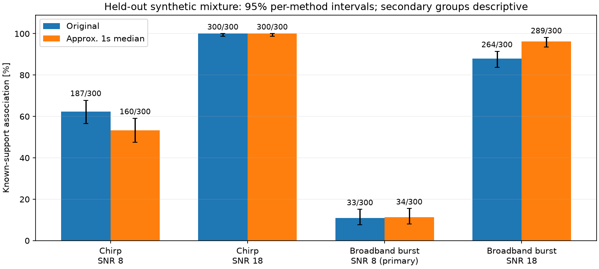
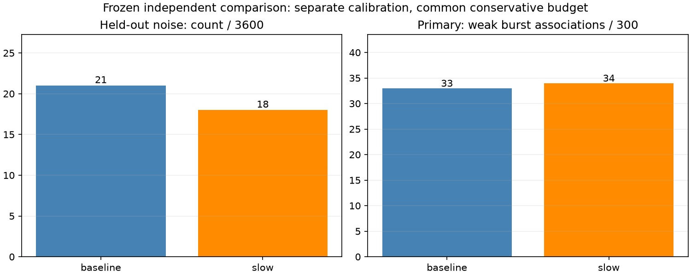

# Independent common-budget comparison: primary gain not established

Run `20261127T114754Z_eefa4de6`; development source `81ca36e454256400dc2674967db268a9aaaf6c56`. [Protocol](protocol.md) was saved and hashed before measurement (internal prespecification, not an external public preregistration). Frozen methods: original transient detector and the existing approximately1s temporal median. All inputs here are newly generated synthetic records; GW170814 and other real waveform files were not used. No method/kernel/threshold tuning after validation.

## Main finding

Both fixed methods satisfy the common overall mixture budget by the predeclared held-out interval check. The primary weak broadband-burst endpoint is33/300original versus34/300prototype, with6slow-only and5baseline-only pairs; exact two-sided McNemar p=1.0. The primary improvement criterion is NOT met. This is absence of evidence for the specified improvement, not proof that the methods are equivalent.

Secondary outcomes show specialization rather than uniform superiority: weak chirp associations decrease187->160/300, strong chirps remain300/300, strong broadband-burst associations increase264->289/300. Do not replace the primary endpoint with that favorable secondary result or attach an unplanned confirmatory p-value to it. No automatic adoption.

## What same budget means in this study

Budget .01 false-alarm windows per nonoverlapping4s observation, equivalent to9false-alarm windows/hour of generated-window exposure. A window with any accepted candidate counts once. This is not an astrophysical event FAR or a continuous-stream deployment guarantee. The target population is one fixed IID synthetic mixture, each record independently selecting stationary pink noise, smooth amplitude drift or a within-window level step with probabilities1/3 each.

Per-scale normalization uses200records(seed15001); threshold selection uses1800different records(seed15002). Both arms have their own normalized score distribution and threshold. A conservative tolerance rank uses per-arm calibration failure allowance.025:tail rankm10,orderk1791,effective conformal alpha10/1801=.00555247084952804. The equivalent Beta97.5% tail-mass upper quantile is.009470248974080742, below the .01budget. Binomial failure at the .01budget is.015008074366413538 per arm. Under the stated IID assumptions, the two tolerance statements provide at least95% joint assurance by union bound, without assuming independence of methods. Strict ties are conservative.

This operating rank is conservatively below the budget, about5false-alarm windows/hour as an unconditional conformal bound under exchangeability, not an assertion that each frozen method must realize exactly5or9/hour. The thresholds were hashed in threshold_freeze.json BEFORE held-out generation and remained byte-identical. Calibration assurance and later evaluation confidence are separate statements; no additional combined-coverage claim is made.

## Independent noise evaluation

3600new IID mixture records(seed15003), equivalent to four hours of independent generated4s-window exposure, were scored by both methods.

| Method | Alarm windows /3600 | Observed fraction | Exact95% interval | Window-equivalent alarms/hour |
| --- | ---: | ---: | --- | ---: |
| Original | 21/3600 | 0.5833% | [0.3614%, 0.8903%] | 5.2500 |
| Approx.1s median | 18/3600 | 0.5000% | [0.2966%, 0.7891%] | 4.5000 |

Both upper bounds are below1%; each exact95% two-sided interval upper endpoint is a97.5% one-sided upper bound. The pair therefore supports a separate at-least95% joint evaluation confidence statement. Observed rates21/3600and18/3600are NOT identical; their difference does not establish a general lower false-alarm rate for the prototype. Paired negative discordances are12slow-only versus15baseline-only windows. This is a common upper-budget comparison, not a claim of exact pointwise matched FAR or ROC dominance.

| Regime | Actual windows | Original count (upper95%) | Approx.1s count (upper95%) |
| --- | ---: | --- | --- |
| stationary | 1193 | 4 (0.8562%) | 3 (0.7331%) |
| smooth_drift | 1153 | 6 (1.1292%) | 8 (1.3625%) |
| within_window_step | 1254 | 11 (1.5641%) | 7 (1.1467%) |

The global mixture assurance does NOT guarantee the same budget within every regime. In particular, conditional drift/step upper bounds extend above1%. These conditional intervals are descriptive and not simultaneous multiple-regime guarantees. Changing the mixture weights or moving to other noise can change the realized overall rate. The level step lasts within one4srecord, not a long adaptive time-series transition.

## Independent signal evaluation

Seed15004generates300independent base/clean units per family, each with an independent regime draw from the same mixture. Each unit is paired across SNR8/18, yielding600distinct base/clean units and1200dependent amplitude records. Within each family/amplitude group,300units are IID conditional on the frozen calibration. Signal support is used only after acceptance to count time/frequency rectangle association; this is not proof that every component cell is injected signal or a measurement of waveform reconstruction quality.

| Family | Root-energy SNR | Original associations | Approx.1s associations | Slow-only / baseline-only | Status |
| --- | ---: | ---: | ---: | --- | --- |
| linear_chirp | 8 | 187/300 | 160/300 | 3 / 30 | Secondary descriptive |
| linear_chirp | 18 | 300/300 | 300/300 | 0 / 0 | Secondary descriptive |
| band_limited_noise_burst | 8 | 33/300 | 34/300 | 6 / 5 | Primary; exact p=1.0, criterion not met |
| band_limited_noise_burst | 18 | 264/300 | 289/300 | 25 / 0 | Secondary descriptive |

Error bars are exact95% per-method binomial intervals under the specified sampling model, not simultaneous family-wide bands. Only the weak-burst SNR8 group had a formal predeclared paired sensitivity test. All secondary group/regime records, lost baseline recoveries and per-method intervals are retained in inference.json and heldout_signals.json. A p-value of1does not prove equivalence.

The earlier small pilot had suggested some gains while also increasing noise nominations. This larger fixed-budget study changes the calibration distribution and adds a conservative budget margin, so its absolute counts are not a direct rerun of those pilot totals. Its own original/prototype comparison is paired and independently evaluated. The primary gain is not established; stronger-burst secondary gains coexist with a substantial observed weak-chirp cost (30baseline-only versus3slow-only cases). No universal best method is established.

## Independent checks and limits

Verification reconstructed both calibrations, all9600arm/window decisions and5296accepted candidates; regenerated all6800input records; checked600paired signal units and126predefined manual map-arm reconstructions. The budget rank is checked by independent Beta/binomial expressions, intervals by binomial-tail inversion and the primary test by an exact combinatorial sum. These are verification counts, not pytest passes or proof of scientific generality.

Split A/B/noise-validation/positive-noise partner hash sets contain200/1800/3600/600unique entries and no cross-split intersections. Hash checks establish no exact reuse; IID/independent-stream claims remain assumptions of the specified pseudo-random generation model, not properties proved by hashes. Input seeds, hashes, profile/waveform parameters and all results are saved. All threshold-freeze and production-source hashes remain unchanged. No measurement failures, interruptions, dropped cases or post-evaluation parameter changes occurred.

The main limitation is scope: one large calibration realization, one pink spectrum, two signal families, one fixed mixture and a window-level association endpoint. No physical sensor, continuous-time data, Workstation/veto/adaptive/Union path or new astrophysical event is validated by this experiment. It does not independently recover GW170814 H1 and does not establish an explanation of that physical miss. There is no Monte Carlo p-value or associated MC standard error here; the primary test is exact.

Reproduce from repository root using experiments/run_common_budget_comparison.py and experiments/verify_common_budget_comparison.py <new-run-directory>, with the recorded production and prototype source versions. The driver refuses historical output writes and creates a new UTC/UUID directory. Archived code copies are provenance; use repository entry points. The supplementary plot_signal_groups.py is standalone in a result folder and refuses plot overwrite. All original/derived waveform/O3 reads and network access are blocked. Arrays are generated in memory, not redistributed as raw files. Figures here use project-generated synthetic data.

## Decision

Keep the original method as the existing default. Preserve the approximately1s median as a characterized research alternative, not a general improvement. A future specialized broadband-burst use case could motivate a new independently planned confirmation, with its own acceptable error budget and explicit protection against weak-chirp losses. Do not enlarge this sample or change kernels/thresholds until a desired p-value appears; any new study needs its own fixed plan.

No production/app change, main merge, release, visibility change or Zenodo update. Unrelated article/CodeQL drafts remain untouched. Deferred DNA-window work and adaptive limitations L09/L10 remain separate. This evidence is saved to development per owner preference.

Preservation history: the first research-commit attempt was rejected by automatic approval review because the user-facing report had to come first; no commit or push ran in that attempt. After the completed report was presented, the owner explicitly approved committing and pushing this research stage to development/v0.3. The earlier pending status is historical. Scientific measurements, inference and verification are unchanged.
