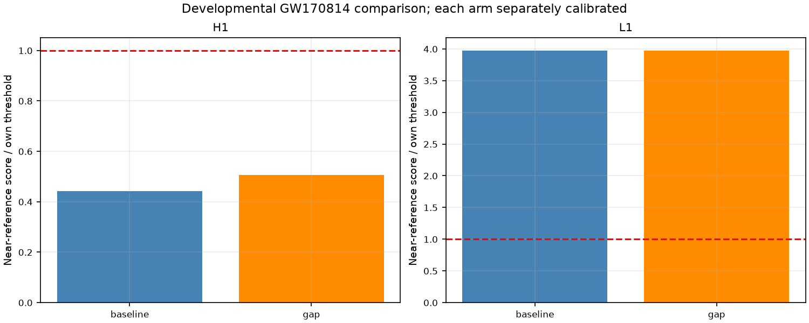
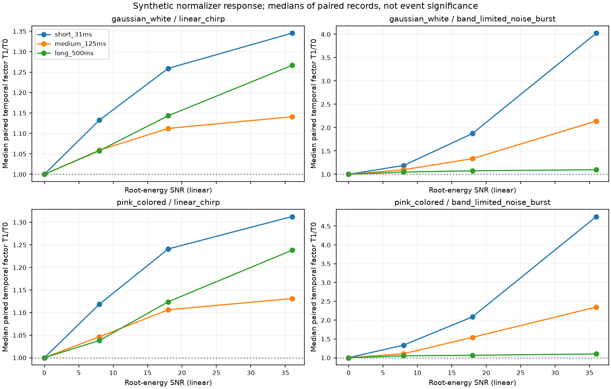

# Gap-link and paired-normalizer controls: two completed tests

Run `20261127T095901Z_b912adbb`; source `3f93cc7d0b3cdfeee45e9be7c974cca478fc6078`. [Protocol](protocol.md) fixed before measurement; [research-only helper](gap_link_prototype.py). All measurement stages completed. Production detector, Workstation and preprocessing source remain unchanged. No new variant is adopted.

## Test A — separately calibrated one-missing-frame clustering

The prototype links existing Z>4 seed cells across at most one missing time frame, only at the same or neighboring frequency index; missing-cell power is not added. Both arms have their OWN Split-A median/spread and Split-B global threshold. New scores are never tested against the old threshold as a recovery claim. Calibration uses the production finite-sample routine on measured raw-score tables; acceptance uses the unchanged production decision routine.

### Developmental GW170814 replay

| Site | Arm | Near-reference standardized score | Own threshold | Empirical window p | Associated raw / post-veto | Off-source raw / post-veto / windows |
| --- | --- | ---: | ---: | ---: | --- | --- |
| H1 | baseline | 1.144807 | 2.590544 | 0.10887097 | False / False | 2 / 1 / 151 |
| H1 | gap | 1.085790 | 2.142738 | 0.10282258 | False / False | 3 / 2 / 151 |
| L1 | baseline | 8.892396 | 2.240084 | 0.00201613 | True / True | 3 / 3 / 151 |
| L1 | gap | 8.809020 | 2.215958 | 0.00201613 | True / True | 5 / 5 / 151 |

The bars compare near-reference score divided by each arm's own threshold; panels have their own vertical ranges. The prototype does not recover H1; L1 remains recovered and survives vetoes. At the event, all three per-scale raw maxima are EXACTLY unchanged in H1 and L1. The strongest event clusters were not enlarged by this particular one-frame link; changes in standardized values/thresholds come from changed background normalization/calibration. This rejects this specific proposed rescue in this case, not every possible fragmentation explanation.

Both baseline event scores/thresholds/p-values and baseline off-source counts reproduce the parent. Off-source post-veto nominations increase H1 1->2 and L1 3->5 over151 windows (604s/site). These are real-data nominations, not certified noise-only false alarms, and the small differences are not a demonstrated population-rate increase. The epoch was already used to design the investigation; CalB follows target, making this offline development evidence rather than independent real-event validation.

### Three fresh synthetic calibration/evaluation realizations

| Seed | Baseline noise /200 | Gap noise /200 | Baseline / gap SNR8 associated recovery | Baseline / gap SNR18 associated recovery |
| --- | ---: | ---: | --- | --- |
| 7301 | 3 | 4 | 7/10 / 7/10 | 10/10 / 10/10 |
| 7302 | 2 | 2 | 4/10 / 4/10 | 10/10 / 10/10 |
| 7303 | 1 | 1 | 6/10 / 6/10 | 10/10 / 10/10 |

Descriptive totals: baseline6/600 versus gap7/600 noise nominations; both recover17/30 SNR8 and30/30 SNR18 injections. All injection decisions match pairwise; the only synthetic discordance is one extra gap-only negative-control nomination in seed7301. This pilot supplies no observed sensitivity benefit. One extra alarm is not statistical proof of general inferiority. No pooling as a common-rate confidence interval across three shared calibrations; the same30 noise/clean realizations are paired across amplitudes, not60 independent injections.

The synthetic distribution here has fixed pink alpha1/knee16Hz and short chirps drawn from the prespecified parameter ranges. It differs from the earlier Workstation pilot (including its13/30 SNR8 result); this17/30 is not an improvement over that historical measurement. Both current arms are compared only on the same new inputs. No Workstation/adaptive/Union or synthetic-veto claim is made.

**Decision:** retain the original detector. Do not enlarge the allowable gap in a loop until this known H1 event triggers. The fixed one-frame prototype remains an archived negative development result; it is not integrated into src/app.

## Test B — what an added signal does to the temporal normalizer

60 independent base noise records (30white,30pink), two injected families and SNR0/8/18/36 produce480 paired mixture records and1,440 scale records. Reuse across families/amplitudes/scales is explicit; they are not480 independent backgrounds. Two software counterfactuals hold the temporal factor or both background factors at the values from the exact noise-only partner.

With P1 fixed, the temporal-only counterfactual obeys **Z_temporal_frozen = Z_production * (T1/T0)** pointwise. A larger T1 therefore lowers the production bin-power ratio relative to this known-noise diagnostic. Spectral S1 is held fixed in that comparison; the fully frozen comparison also changes S. These are oracle diagnostics, not deployable calibrated replacement detectors.

All prespecified group medians T1/T0 are shown below (30 paired records per model/family/amplitude/scale; complete min/max and increases/decreases in normalizer_aggregates.json).

| Noise | Signal family | Root-energy SNR | 31ms median T1/T0 | 125ms median T1/T0 | 500ms median T1/T0 |
| --- | --- | ---: | ---: | ---: | ---: |
| gaussian_white | linear_chirp | 0 | 1.000000 | 1.000000 | 1.000000 |
| gaussian_white | linear_chirp | 8 | 1.132550 | 1.058965 | 1.057755 |
| gaussian_white | linear_chirp | 18 | 1.259112 | 1.112177 | 1.143216 |
| gaussian_white | linear_chirp | 36 | 1.345268 | 1.140891 | 1.266581 |
| gaussian_white | band_limited_noise_burst | 0 | 1.000000 | 1.000000 | 1.000000 |
| gaussian_white | band_limited_noise_burst | 8 | 1.189159 | 1.096436 | 1.047811 |
| gaussian_white | band_limited_noise_burst | 18 | 1.873520 | 1.335693 | 1.075347 |
| gaussian_white | band_limited_noise_burst | 36 | 4.023679 | 2.140426 | 1.097445 |
| pink_colored | linear_chirp | 0 | 1.000000 | 1.000000 | 1.000000 |
| pink_colored | linear_chirp | 8 | 1.118503 | 1.046320 | 1.038120 |
| pink_colored | linear_chirp | 18 | 1.240820 | 1.106117 | 1.123873 |
| pink_colored | linear_chirp | 36 | 1.312543 | 1.131036 | 1.237928 |
| pink_colored | band_limited_noise_burst | 0 | 1.000000 | 1.000000 | 1.000000 |
| pink_colored | band_limited_noise_burst | 8 | 1.334704 | 1.105583 | 1.050506 |
| pink_colored | band_limited_noise_burst | 18 | 2.086649 | 1.541429 | 1.065251 |
| pink_colored | band_limited_noise_burst | 36 | 4.753310 | 2.346518 | 1.099170 |

Each panel has its own vertical range. Lines join four specified amplitudes; they are not confidence intervals or a measured continuous response. Values describe the median of per-record median ratios over known active time-frame centers, not event significance, physical SNR attenuation or recovered detection efficiency.

The paired construction establishes that adding these signals can change the estimated temporal background. For pink-noise broadband bursts, short-scale median T1/T0 is2.086649 atSNR18 and4.753310 atSNR36; for pink chirps it is1.240820 and1.312543. This makes local normalization a concrete sensitivity-design question. It does not establish that the real H1 wave raised its denominator, or quantify H1 detection loss.

The effect is not universal in every realization/scale. AtSNR18 the long-scale broadband-burst factor decreases in6/30 white-noise and7/30 pink-noise pairs. All SNR0 maps/factors reproduce the noise-only partner exactly (360scale-level identity controls). Full ranges and both directions remain in the exports.

The code estimates a temporal envelope from the median across whitened frequencies and smooths it over31/15/7 frames at hops3.90625/31.25/125ms. A sufficiently broad/lasting transient can affect that estimate; distinguishing such a transient from a real noise-amplitude change is a design tradeoff. The measured dependence is consistent with that mechanism. No replacement envelope estimator or its detection performance was evaluated here.

**Decision:** a future robust/independently estimated temporal-envelope variant is worth specifying and calibrating. It must operate without access to the synthetic noise-only partner or an event-time oracle. It needs separate noise-drift controls and independent false-alarm/sensitivity evaluation. Do not remove normalization or reuse old thresholds on the strength of this diagnostic.

## Verification, failures and preservation

- Focused prototype controls:9named topology fixtures,20independent random-mask graph-oracle comparisons, strict Z>4 boundary, post-link singleton qualification and no double counting. Separate verification checked10calibrations,1960arm/window decisions,362accepted candidates,2,100synthetic input-regeneration records (not independent realizations),1,440normalizer records,48aggregates and a predefined48-map subset reconstructed from manual normalization equations. These are experiment/verification counts, not new pytest passes.
- Original two O2 input hashes match the parent after completion; all production and parent source/artifact hashes match. Strict JSON, full raw calibration features/nulls/candidates/evaluation/normalizer records and exact protocol/driver/helper copies are saved. Generated arrays remain in memory, not Git. The independent verifier does not read real waveform data or O3.
- Measurement stages completed without interruption or parameter correction. A later supplemental verification JSON write initially failed because D: filesystem escalation was omitted. No measurement output was modified; the supplemental check was repeated with authorized write access and its failure/retry recorded in paired_preservation_check.json and research history. Do not conflate that export-permission failure with a detector-test outcome.
- Reproduce from repository root using experiments/run_gap_normalizer_controls.py and experiments/verify_gap_normalizer_controls.py <new-run-directory>, with the recorded unchanged production hashes and local O2 files. The driver creates a fresh run and records actual HEAD/dirty paths. Archived driver/helper files are exact provenance copies; use repository entry points.
- No source/app/browser/test behavior changes, new real event, O3/manifest access, coincidence/significance calculation or release/Zenodo operation. Unrelated article and CodeQL drafts remain separate. Adaptive background-admission limitations L09/L10 and the deferred DNA-window hypothesis remain unresolved/separate.

Real-data attribution: GWOSC / LIGO Scientific Collaboration / Virgo Collaboration, CC BY4.0. [GWOSC acknowledgement](https://gwosc.org/acknowledgement/). Project MIT does not supersede the data license. No new astrophysical discovery or general real-data FAR guarantee.
