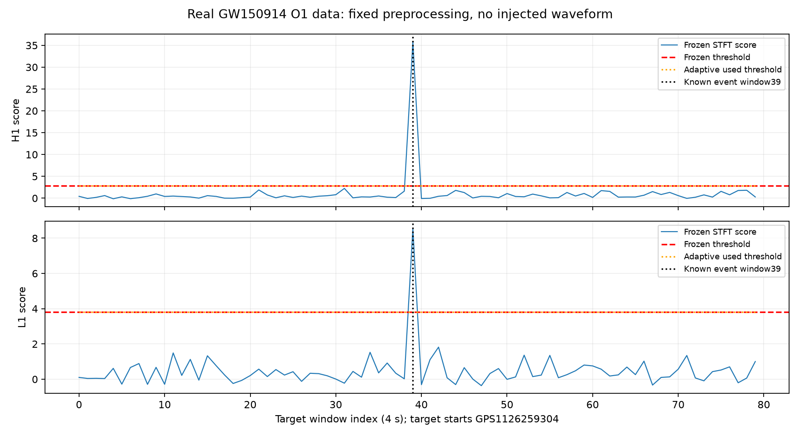
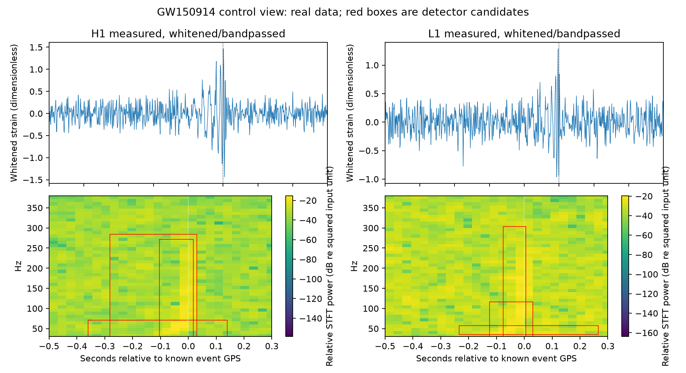
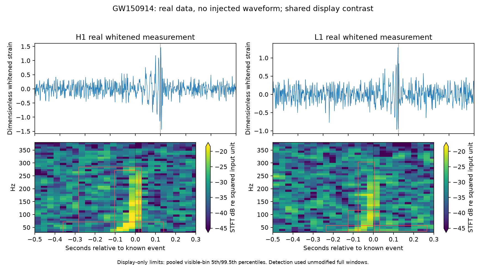

# GW150914 current-code real-data control

Run `20261126T170822Z_c5b3ad43`; source `3497211e0f19832a5e1bd268971e9e3cbc0b83d6`. Previously used O1 epoch; no injected waveforms, tuning or blind-discovery claim.

## Actual outcomes

| Site | Frozen event score / threshold | Event window nominated | Reference-associated candidates | Adaptive event detected / available | Background-control nominations | Target off-source nominations |
| --- | --- | --- | --- | --- | --- | --- |
| H1 | 35.767336 / 2.8053933 | True | 3 | True / True | 4/320 | 0/71 |
| L1 | 8.5280275 / 3.8046363 | True | 3 | True / True | 3/320 | 0/71 |

The background fractions are nomination fractions on real data, not an established population FAR. The two sites are not pooled as independent trials. No coincidence significance or new event is inferred.

## Measured-data figures

The event figure displays a fixed[-0.5,+0.3]s region around the known reference for inspection; detection used the full four-second window. Display30–380Hz is not a hard detector-bin mask. Preprocessing is offline and zero-phase with1s padding; residual edge effects and neighboring shared context remain possible.

## Reproducibility and quality

- Frozen PSD fit/calibration/target/control block footprints are disjoint, including padding; complete prescribed block counts were required.
- Raw file hashes match stored official GWOSC provenance. Source hashes are unchanged. Exact local CSV/NPY hashes are saved; CSV values and GPS times round-trip exactly.
- All frozen score/threshold/empirical-p decisions and adaptive available decisions were independently recomputed from saved files. Candidates retain GPS timing and scale metadata.
- DATA flags were required; all other DQ and hardware-injection bit masks/definitions are preserved in per-site provenance and quality_windows.csv. A data-quality pass does not prove astrophysical origin.
- Direct Workstation target JSON/CSV are saved. Prepared local data files are already whitened; do not preprocess twice. Live UI file ingestion is not claimed verified under the reserved-manifest constraint.
- Attempt1 failed in new-driver calibration serialization before target analysis; it remains preserved separately. The rerun changed API calls only.

## Interpretation

Use event-window nomination, reference-associated candidate morphology/timing and H1/L1 comparison to assess this known positive control. A successful control establishes this configuration's recovery on these selected files, not universal sensitivity or confirmation independent of the published event.
If frozen/adaptive disagree or background candidates appear, preserve them for inspection rather than lowering the threshold or labelling every candidate a discovery.

## Data attribution

Measured strain supplied by the Gravitational Wave Open Science Center and the LIGO Scientific Collaboration/Virgo Collaboration; GWOSC currently serves the LIGO-Virgo-KAGRA community. Original data:CC BY4.0. Transformations: independent PSD whitening,30–380Hz bandpass and4096->1024Hz antialiased decimation; figures and local derivative files were generated for this control.
Sources: [GW150914 release](https://gwosc.org/events/GW150914/), [GWOSC data acknowledgement/licensing](https://gwosc.org/acknowledgement/), R.Abbott et al., [O1/O2 open data, SoftwareX13(2021)100658](https://doi.org/10.1016/j.softx.2021.100658). The project's MIT license does not replace the source data's CC BY terms.

No O3 input/manifest or non-allowlisted data were accessed; network was blocked during measurement. Original and large derived waveform files remain outside git.

## Diagnostic interpretation and readable display follow-up

See [the concise measurement interpretation](../../../docs/GW150914_REAL_DATA_CONTROL_2026-11-26.md) for event mask127 at both sites, H1 injection mask31 vs L1 mask23 (NO_CW_HW_INJ not passing), L1 event-window GLITCH_STORM with preserved detection, and the limitation of different-scale peak times as delay estimates. Neither warning nor the CW flag alone identifies the transient origin. No adaptive regime update occurred in the target sequence; this does not resolve adaptive recovery/admission limitations.

The original full-range plot is retained. The added figure uses common pooled visible-bin5th/99.5th percentile display limits, saved in display_contrast.json; underlying arrays, detector scores and thresholds are unchanged.
