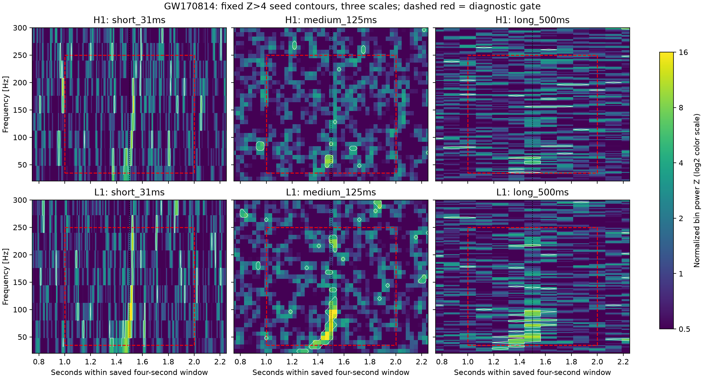
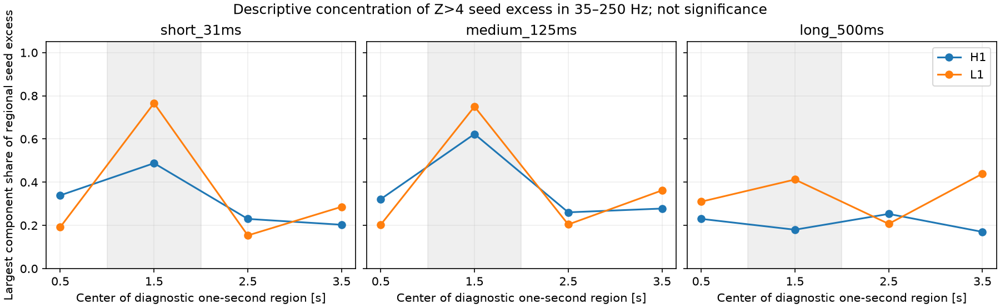

# GW170814 cluster-map diagnosis: established mechanism and candidate changes

Run `20261127T093636Z_698294e8`; source `565e5cc629342346b034e7fac47ad432d2ff388b`. [Protocol](protocol.md) specified before reconstruction. Exactly two saved H1/L1 processed event arrays were read and hash-verified. No original strain, new event, V1 or O3 was read; no calibration, detector setting, seed threshold or decision rule was changed.

## What is confirmed

The frozen implementation has the recorded behavior: Z>4 seeds, eight-neighbor connectivity, at least two cells, score=sum(Z-1) within each connected component. All 286 qualified parent clusters reproduce. A separate graph traversal checks all 520 components including singletons; independent reconstruction checks all six normalization maps. A separate CSV/JSON verifier checks all 1,345 saved seed pixels, 520 components and 24 regional records. These are diagnostic arithmetic/topology checks, not additional pytest cases or scientific detection validation.

H1 forms a reference-associated component at every scale, but each is below its own raw boundary implied by the unchanged standardized threshold. L1 forms larger/stronger accepted components. No implementation discrepancy in these map/cluster calculations was found.

| Site | Scale | Strongest bbox-associated component cells | Full component raw score | Raw acceptance boundary | Standardized score | Accepted |
| --- | --- | ---: | ---: | ---: | ---: | --- |
| H1 | short_31ms | 20 | 123.224760 | 192.181715 | 1.144807 | False |
| H1 | medium_125ms | 5 | 36.047195 | 88.317264 | 0.193506 | False |
| H1 | long_500ms | 3 | 16.547124 | 82.401133 | -0.960396 | False |
| L1 | short_31ms | 57 | 464.723881 | 174.588563 | 8.580261 | True |
| L1 | medium_125ms | 32 | 255.509778 | 87.882687 | 8.892396 | True |
| L1 | long_500ms | 17 | 106.505009 | 93.151681 | 2.778833 | True |

## What the maps add

All panels use the same fixed Z color scale; white contours are the strict Z>4 seed mask. The dashed red box is the loose local1–2s,35–250Hz diagnostic gate; the vertical dotted line is the known reference1.5s. No waveform track is inferred. These are normalized-bin-power maps, not physical strain amplitudes, SNR or source probabilities. Out-of-view frequency bins still contribute to the unchanged whole-window detector.

For descriptive cell metrics, use bin CENTERS in local[1,2)s and35..250Hz; this is distinct from the parent cluster RECTANGLE-intersection association. Regional contribution counts only member cells within the region, whereas the whole-component raw score above can extend outside it.

| Site | Scale | Seed cells in reference cell region | Components touching region (all / qualified) | Sum of regional seed excess | Largest component regional share |
| --- | --- | ---: | --- | ---: | ---: |
| H1 | short_31ms | 52 | 12 / 10 | 252.581522 | 48.79% |
| H1 | medium_125ms | 11 | 6 / 2 | 57.866175 | 62.29% |
| H1 | long_500ms | 23 | 14 / 7 | 91.915707 | 18.00% |
| L1 | short_31ms | 68 | 12 / 10 | 473.931425 | 76.58% |
| L1 | medium_125ms | 43 | 11 / 4 | 305.953486 | 75.00% |
| L1 | long_500ms | 48 | 11 / 7 | 258.318661 | 41.23% |

H1 short-scale regional seed excess is less concentrated in the largest component (48.79%) than L1 (76.58%). On the medium scale the shares are62.29%/75.00%. H1 also has much less medium-scale seed excess (57.87 vs305.95) and fewer seeds (11 vs43). At the short scale both sites touch12 components (10 qualified), so a claim that H1 simply has more fragments than L1 is not supported. The distinction concerns component strength/concentration as well as raw seed content, not component count alone.

These observations support investigating a fragmented/weak seed representation; they do NOT prove that separate H1 components belong to the same gravitational wave, or that fragmentation caused the miss. Some contributions can be noise. In H1 the later3–4s medium-scale region has seed excess120.97, exceeding the reference region57.87. In L1 the long-scale concentration is43.92% in3–4s versus41.23% near the reference despite much less total excess. Thus neither an arbitrary seed sum nor concentration alone uniquely identifies the event in this record. Do not compare those new sums with the original cluster threshold to claim recovery.

Gray shading identifies the reference-associated one-second cell region. Neighboring regions are descriptive context, not certified noise controls. End regions have different usable STFT frame counts. Cells, overlapping STFT frames and scales are correlated; no uncertainty/significance or independent-replication claim is attached to these curves.

## Local normalization is another hypothesis

Z=P/(S_bg*T_bg). The median temporal-envelope factor inside the reference second is about1.225/1.223/1.183 for H1 across the three scales, versus0.993/0.962/0.910 outside. L1 values are0.964/1.034/1.000 inside versus1.003/0.975/0.973 outside. These descriptors show that local division differs across sites/time. They do not establish that the actual wave raised the envelope, quantify a causal sensitivity loss, or justify removing this factor. Such a claim requires a paired intervention with known inputs and calibration for any resulting detection rule.

## Concrete candidates for future tests — none adopted

1. **A bounded temporal-gap clustering variant.** Retain Z>4 and the original adjacency. Add only connections between existing seed cells two time-frame indices apart and at the same or neighboring frequency index: at most one intervening frame may be missing. Do not add unseeded-cell power; count every seed once. This is a small, explicit candidate, not a fit to a chosen chirp or a demonstrated repair. The maximum new center separation is two hops:7.8125ms/62.5ms/250ms across scales; the different physical scales must be disclosed. No new variant has been executed in this stage.
2. **A paired local-envelope mechanism control.** On separately specified known-noise/known-injection inputs, measure how the temporal normalizer changes when a transient is added. This can test self-normalization without labeling all observed H1 seed cells as signal. It is not yet a replacement normalization rule.
3. Any adopted score/connectivity/normalization variant needs its own complete Split-A normalization and Split-B global threshold calibration, followed by predefined off-source and signal checks. Apply it everywhere, never only around the published event time. Keep the original detector as comparator, retain misses, control false alarms per equal observation time, and validate on independent cases. H1 must not be both the sole design target and sole success criterion. A higher raw score alone is not an improvement.

## Limits and preservation

The confirmed software mechanism is weak individually accepted seed components under the current rule; a physical explanation of why H1 is weak remains unisolated. No recovered H1 event, new astrophysical significance or general sensitivity gain is claimed. The previous four-phase grid result and adaptive L09/L10 limitations are unchanged. The owner's DNA-window idea remains deferred.

All source/parent/input hashes remained unchanged. Reproduce via `experiments/analyze_gw170814_cluster_maps.py` from the repository root with the recorded unchanged production source hashes and the two local saved arrays. The driver creates a fresh output directory; it permits later documentation-only HEADs if production hashes match. Run `experiments/verify_gw170814_cluster_maps.py <new-run-directory>` for a separate saved-record check. Archived drivers are provenance copies; use repository entry points. Original arrays and full maps stay outside Git; seed records, component geometry, figures and exact fingerprints are preserved. No production/test/article edits were included in this stage.

Data and derived figures: GWOSC / LIGO Scientific Collaboration / Virgo Collaboration, CC BY4.0. [GWOSC acknowledgement](https://gwosc.org/acknowledgement/). Project MIT does not replace the data license.
