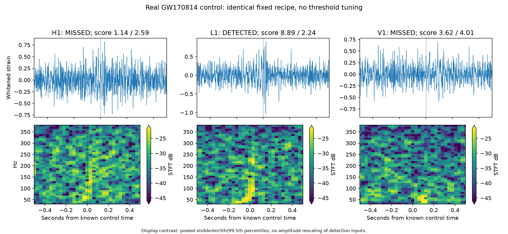
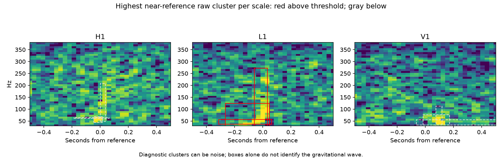

# GW170814 bounded real-data replay

Source8f78ca5b141ea656957dc69aa275daac4d71eeb0; run20261126T174011Z_e21955d7. Previously used O2 epoch; same historical partition,707calibration/160target windows, fixed detector and reversible vetoes. CalB is after target:offline control, not causal deployment.

| Site | Event score | Threshold | Raw / post-veto event | Off-source raw / post-veto (N=151) | Historical six checks agree |
| --- | --- | --- | --- | --- | --- |
| H1 | 1.1448066 | 2.5905444 | False / False | 2 / 1 | True |
| L1 | 8.8923961 | 2.2400842 | True / True | 3 / 3 | True |
| V1 | 3.6191735 | 4.0068912 | False / False | 2 / 2 | True |

## Interpretation
- H1/V1 below-threshold decisions are already misses before vetoes; vetoes did not cause those misses. Per-scale maxima and subthreshold seed-qualified clusters are preserved in event_diagnostics.json.
- A numerical threshold gap explains the code decision. Lower instrument response, local noise and STFT morphology are possible physical/statistical causes, not proven causal explanations by this replay.
- Event-window nomination is a control association, not independent confirmation or a new event. Coarse peak matches are saved separately and do not provide astrophysical significance. No time-slide/background significance was run.
- Off-source nominations are real-data candidates, not certified noise-only false alarms. Extreme V1 candidates and all veto reasons are preserved; no novelty claim.
- Compare with GW150914 carefully: its separate protocol used320calibration windows rather than707. These selected previously examined events are not a representative efficiency estimate; do not quote3/5 detector-event recovery as a population rate.

## Preservation and attribution
All source/historical hashes and full-precision decisions were independently checked; raw data hashes were checked before measurement. Original/processed event arrays stay ignored/local, with exact hashes. Historical array bytes cannot be independently reconstructed from old reports alone.
Data: GWOSC/LIGO Scientific Collaboration/Virgo Collaboration, CC BY4.0. [Event release](https://gwosc.org/events/GW170814/), [acknowledgement/licensing](https://gwosc.org/acknowledgement/). Processing: independent PSD whitening,30–380Hz smooth bandpass and4096->1024Hz antialias decimation; display contrast affects figures only.
No injected waveform, detector tuning, O3/manifest, extra event, main merge, release or Zenodo operation. Detailed scientific article deferred.

## Full historical-candidate comparison and subthreshold display

All22 candidates match historical coordinates/scores/p-values and veto reasons at the saved precision; see historical_candidate_comparison.json. Raw near-reference seed clusters exist in the H1/V1 event windows, but their maxima remain below threshold. V1p=5/496=0.01008065 is just above0.01; this is a valid available non-detection, not a floating-point tolerance defect. Physical cause of the score gap remains unisolated.

See [combined known-event map](../../../docs/KNOWN_EVENT_CONTROL_MAP_2026-11-26.md) for both tested events and limitations on pooled interpretation.
