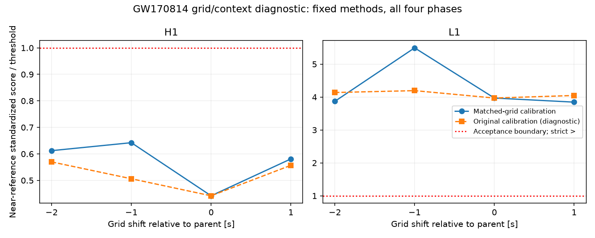

# GW170814: predefined window-grid/context diagnostic

Run `20261127T075035Z_5855141b`; source `32388bedf6a1222cdb27b5531e3302787014dd28`. [Protocol](protocol.md) fixed before execution. All eight site/phase variants completed; no detector/preprocessing implementation was changed. This is an exploratory analysis of a previously examined O2 event, not independent discovery or an optimized search.

## Main result

H1 remains below threshold at every predefined grid phase; L1 retains reference-associated accepted candidates before and after the original vetoes at every phase. The same classification holds for the event-only comparator using the original zero-phase calibration. This does not support rescuing H1 by any of the four tested grid shifts. It does not prove alignment is irrelevant at all offsets.

| Site | Grid shift (s) | Event position in window (s) | Near-reference score | Matched threshold | Associated raw / post-veto | Off-source raw / post-veto / windows |
| --- | ---: | ---: | ---: | ---: | --- | --- |
| H1 | -2 | 3.5 | 1.602258 | 2.617220 | False / False | 4 / 3 / 150 |
| H1 | -1 | 2.5 | 1.554010 | 2.419611 | False / False | 4 / 3 / 151 |
| H1 | +0 | 1.5 | 1.144807 | 2.590544 | False / False | 2 / 1 / 151 |
| H1 | +1 | 0.5 | 1.307140 | 2.249736 | False / False | 5 / 4 / 150 |
| L1 | -2 | 3.5 | 10.072417 | 2.602847 | True / True | 1 / 1 / 150 |
| L1 | -1 | 2.5 | 12.209108 | 2.222194 | True / True | 1 / 1 / 151 |
| L1 | +0 | 1.5 | 8.892396 | 2.240084 | True / True | 3 / 3 / 151 |
| L1 | +1 | 0.5 | 9.702675 | 2.523188 | True / True | 2 / 2 / 150 |

The panels use different vertical ranges to resolve H1 subthreshold variation; compare numerical ratios rather than curve heights. The plotted quantity is a descriptive score/threshold ratio: a strict crossing of 1 is required. Solid lines use matched-grid calibration; dashed lines use the original calibration on the same event observation. Lines connect four predefined cases and do not represent a measured continuous response or confidence interval. Only clusters intersecting the existing reference +/-0.5s,35–250Hz gate contribute to the near-reference maximum. This loose association does not establish waveform identity; no regional or across-phase p-value is calibrated.

## Design and interpretation

- Phases0,-2,-1,+1s shift CalA,CalB and target together. Each has707calibration observations (212normalization/495threshold),160target windows and the original fixed FAP.01/scales/vetoes. Each site uses one background model fitted to the original independent60-window PSD block. No phase was selected or substituted into the detector after seeing results.
- Full padded block footprints are disjoint and in bounds. Adjacent core windows have overlapping1s context, and phases share underlying samples: they are not independent replications. Off-source denominators are150or151 (600or604s), after excluding padded overlap with the fixed event guard. Off-source nominations are not certified noise-only false alarms; these fractions are not pooled or used to claim1% real-data FAR.
- Window-local median removal, taper, FFT whitening and filtering are repeated by the unchanged preprocessing function, and per-window normalization/clustering can change. Thus the perturbation is not an isolated STFT intervention. All shifts are integer seconds, also integer multiples of the4/32/128-sample STFT hops at1024Hz: this does NOT test finer STFT hop-phase offsets.
- CalB is after the target: offline diagnosis, not causal adaptive operation. Operational calibration availability and internal audit status do not prove stationarity/exchangeability.
- H1 original-calibration near-reference scores span1.144807..1.475957 against the same2.590544 threshold. L1 spans8.892396..9.396210 against2.240084. Both observational/context changes and matched recalibration change reported scores, without changing event-associated acceptance in these cases. No physical response/noise/fragmentation cause is isolated.
- DQ and injection flags are retained in every timeline. The event windows retain the GWOSC CW_HW_INJ annotation; gate association and a DATA-pass flag are not independent source identification. No new hardware injection was added.

## Independent checks and preservation

- Verified 1280 target-window empirical p-values, strict threshold decisions, candidate/veto consistency, actual roles/counts/exposure and all 1160 event raw-cluster standardizations under both calibrations. Verified threshold order statistics and per-scale/near-reference maxima. These are arithmetic/record checks, not additional pytest cases or proof of scientific validity.
- Zero-phase event scores/thresholds/p-values and off-source counts reproduce the parent H1/L1 replay. Source and parent artifact hashes match. Original raw input SHA256 was checked before detector execution; the independent verifier reads only saved records and does not reload waveforms.
- Full timeline/calibration/null/audit/candidate/event-cluster records and processed event-array hashes are retained. No waveform arrays are written by this run. Existing historical artifacts, detector/app code and unrelated CodeQL/article drafts remain untouched. O3/manifest/network are blocked by the driver; only two explicit O2 raw paths are used.
- Reproduction requires an isolated checkout at the recorded source HEAD32388be, with this run's archived driver copied into `experiments/run_gw170814_window_grid.py` and archived protocol into `docs/gw170814_window_grid_protocol_2026-11-27.md` (these new files were not yet in that baseline commit). Also copy the archived verifier to `experiments/verify_gw170814_window_grid.py`. From that checkout root run `.venv/Scripts/python.exe -B experiments/run_gw170814_window_grid.py` at the recorded source (the driver creates a fresh run), then `experiments/verify_gw170814_window_grid.py <new-run-directory>`. Copies under this result directory record the exact driver/verifier; use repository entry points. The driver intentionally stops on a different HEAD or changed production sources.

## Decision

Keep the original H1 miss and L1 success. Do not adopt a winning alignment, lower the threshold, or label the4/4 result a population efficiency. This bounded question is answered: the four tested grid/context shifts do not reverse the outcome. Any finer-hop, resolution, background or signal-morphology intervention requires its own predefined calibrated comparison. Adaptive admission-rule limitations L09/L10 remain unresolved.

Data and derived figure: GWOSC / LIGO Scientific Collaboration / Virgo Collaboration, CC BY4.0. [GWOSC acknowledgement](https://gwosc.org/acknowledgement/). Project MIT does not supersede the data license. No new astrophysical significance or novelty claim.
