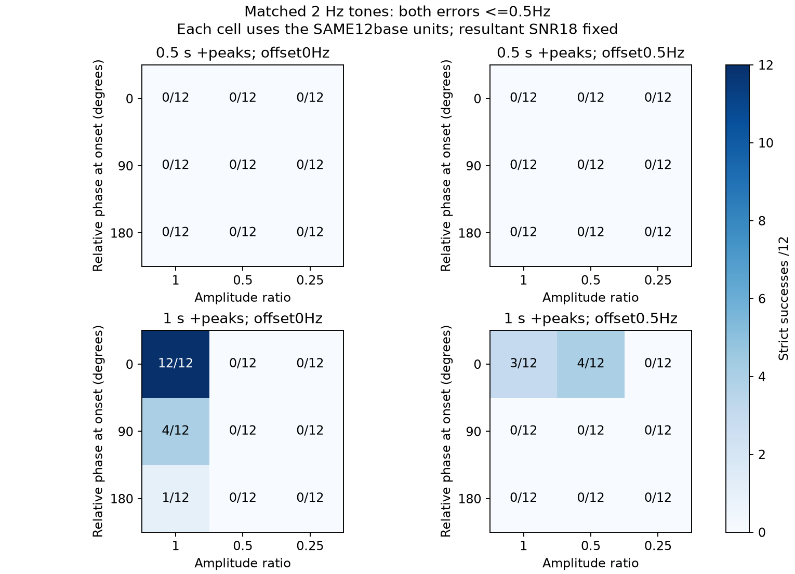

# Matched 2 Hz grid, phase and amplitude interventions

Run `20261128T115035Z_bf957291`; source `fc99a63915cc5137976ea493df1fb61fe6d803d6`. [Frozen protocol](protocol.md), [verification](independent_verification.json), [paired contrasts](paired_transitions.csv), [marginal counts](stratified_counts.csv).

## What is new

BSD-20/21 previously found five loose / four strict gap-2Hz successes, but noise/carrier/global phase changed across cases. Here12fresh base units retain identical noise, even base carrier and global phase across18variants:2grid offsets x3relative phases x3amplitude ratios. Gap2Hz, resultant root-energySNR18, one-second Tukey envelope and onset1.25s fixed. There are216variant cases, not216independent base draws. Both W banks and D diagnostics are unchanged. No source separation, music-stem reconstruction or physical identification is performed.

Offsets0and0.5Hz shift both carriers, preserving gap/noise/phases. Relative phase is at onset, not constant in time. Fixing resultant energy changes individual amplitudes when phase or ratio changes; shifting carrier in colored noise can change its local noise level. These are bounded matched interventions, not isolated universal phase or FFT-grid effects.

New anomaly calibrations (284noise,85A/199B) and pair controls (199noise+199single) use disjoint streams and per-arm thresholds, frozen before any evaluation inference. No tuning, added seeds or exclusions. The same12noise bases supply12matched noise and24matched single controls;160new independent noise and160new single controls are also reported separately.

Primary success: at most one distinct frequency pair, BOTH errors<=0.5Hz under one-to-one matching. Retain secondary<=1Hz. Exact duplicate estimates are invalid; a claim on one/noise is false regardless of how close one estimate is to the tone. Truth is evaluator-only.

## Main matched results

| Arm | Anomalies /216 | Pair claims | Correct <=0.5Hz | Correct <=1Hz | Wrong under0.5Hz | Wrong under1Hz |
| --- | ---: | ---: | ---: | ---: | ---: | ---: |
| W0D0 | 216 | 0 | 0 | 0 | 0 | 0 |
| W0D1 | 216 | 0 | 0 | 0 | 0 | 0 |
| W1D0 | 216 | 0 | 0 | 0 | 0 | 0 |
| W1D1 | 216 | 29 | 24 | 25 | 5 | 4 |

### Grid offset (Hz)

Strict successes; each denominator is a number of VARIANTS sharing12bases, not independent trials.

| Value (variants) | W0D0 | W0D1 | W1D0 | W1D1 |
| --- | ---: | ---: | ---: | ---: |
| 0 (108) | 0 | 0 | 0 | 17 |
| 0.5 (108) | 0 | 0 | 0 | 7 |

### Relative phase at onset (radians)

Strict successes; each denominator is a number of VARIANTS sharing12bases, not independent trials.

| Value (variants) | W0D0 | W0D1 | W1D0 | W1D1 |
| --- | ---: | ---: | ---: | ---: |
| 0 (72) | 0 | 0 | 0 | 19 |
| 1.5707963 (72) | 0 | 0 | 0 | 4 |
| 3.1415927 (72) | 0 | 0 | 0 | 1 |

### Weaker/stronger amplitude ratio

Strict successes; each denominator is a number of VARIANTS sharing12bases, not independent trials.

| Value (variants) | W0D0 | W0D1 | W1D0 | W1D1 |
| --- | ---: | ---: | ---: | ---: |
| 0.25 (72) | 0 | 0 | 0 | 0 |
| 0.5 (72) | 0 | 0 | 0 | 4 |
| 1 (72) | 0 | 0 | 0 | 20 |

## Within-base contrasts

Each paired contrast has12independent BASE UNITS while fixing the other factors. Both=success in both settings; a-only/b-only=transition; neither=failure in both. The complete132contrast rows preserve all arms, phases and ratios. The following grid contrasts focus on W1D1. No confirmatory p-values or best-cell selection.

| Fixed phase / ratio | Both | On-grid only | Off-grid only | Neither |
| --- | ---: | ---: | ---: | ---: |
| 0 / 1 | 3 | 9 | 0 | 0 |
| 0 / 0.5 | 0 | 0 | 4 | 8 |
| 0 / 0.25 | 0 | 0 | 0 | 12 |
| 1.5708 / 1 | 0 | 4 | 0 | 8 |
| 1.5708 / 0.5 | 0 | 0 | 0 | 12 |
| 1.5708 / 0.25 | 0 | 0 | 0 | 12 |
| 3.14159 / 1 | 0 | 1 | 0 | 11 |
| 3.14159 / 0.5 | 0 | 0 | 0 | 12 |
| 3.14159 / 0.25 | 0 | 0 | 0 | 12 |

## False claims and missed stages

| Arm | Independent noise false pairs /160 | Independent single false pairs /160 | Matched noise false pairs /12 | Matched single false pairs /24 |
| --- | ---: | ---: | ---: | ---: |
| W0D0 | 0 | 0 | 0 | 0 |
| W0D1 | 0 | 0 | 0 | 0 |
| W1D0 | 0 | 0 | 0 | 0 |
| W1D1 | 0 | 0 | 0 | 0 |

Independent-control exact95% two-sided intervals (conditional on the frozen calibration/population; methods share inputs):

- W0D0 independent_noise: 0/160, interval[0.000%,2.279%].
- W0D0 independent_one: 0/160, interval[0.000%,2.279%].
- W0D1 independent_noise: 0/160, interval[0.000%,2.279%].
- W0D1 independent_one: 0/160, interval[0.000%,2.279%].
- W1D0 independent_noise: 0/160, interval[0.000%,2.279%].
- W1D0 independent_one: 0/160, interval[0.000%,2.279%].
- W1D1 independent_noise: 0/160, interval[0.000%,2.279%].
- W1D1 independent_one: 0/160, interval[0.000%,2.279%].

Matched controls are not pooled with the independent controls. Zero of160does not validate1% false-pair control or a real-sensor guarantee. Pair-cutoff sentinel semantics remain as before; null means missing-proposal/-infinity, not a failed calibration. The manifest and frozen thresholds retain actual cutoffs.

- W0D0 main decision stages: {'no_pair_proposal': 216}. Wrong claimed pairs are retained in addition to these availability/proposal stages.
- W0D1 main decision stages: {'no_pair_proposal': 216}. Wrong claimed pairs are retained in addition to these availability/proposal stages.
- W1D0 main decision stages: {'no_pair_proposal': 216}. Wrong claimed pairs are retained in addition to these availability/proposal stages.
- W1D1 main decision stages: {'claim': 29, 'no_pair_proposal': 187}. Wrong claimed pairs are retained in addition to these availability/proposal stages.

## Timing and runtime

Timing on correct frequency estimates only, with different selected subsets; no paired accuracy claim from these medians. Observed support[1.25,2.25]s, midpoint1.75s. Boundary/onset robustness is not tested anew.

| Arm | Strict success n | Median absolute onset/end/midpoint error(s) |
| --- | ---: | --- |
| W0D0 | 0 | {'onset': None, 'end': None, 'midpoint': None} |
| W0D1 | 0 | {'onset': None, 'end': None, 'midpoint': None} |
| W1D0 | 0 | {'onset': None, 'end': None, 'midpoint': None} |
| W1D1 | 24 | {'onset': 0.1875, 'end': 0.1875, 'midpoint': 0.0} |

W0: bank median/p95=21.437/34.775ms; D1 proposal median/p95=0.137/0.395ms. Shared re-labeling and archive I/O are not contained in individual proposal timers. These are mixed-case warm-process measurements, not end-to-end streaming latency.

W1: bank median/p95=24.321/38.890ms; D1 proposal median/p95=0.194/0.529ms. Shared re-labeling and archive I/O are not contained in individual proposal timers. These are mixed-case warm-process measurements, not end-to-end streaming latency.

## Evidence and limitations

All calibration/evaluation records are saved directly as JSON gzip archives.504matched-condition NPZ traces retain waveform,complexSTFT,power,background,Z,mask,labels; independent negative-control full maps were not saved. Large traces remain local/gitignored with hashes. Historical artifacts and production source hashes are unchanged. The source pin, scripts, calibration data and generator metadata permit separate fresh-folder reproduction.

Verification PASS: {'calibrations': 2, 'trace_maps': 504, 'claims': 2288, 'matching': 864, 'regenerated_inputs': 572, 'matched_bases': 12, 'status': 'PASS', 'paired_contrasts': 132, 'source_and_historical_hashes_unchanged': True, 'thresholds_unchanged': True}. These are scoped record/map checks, not pytest counts or proof of scientific validity.

No measurement failure, excluded seed, invalid case, parameter adjustment, interruption or waveform-study rerun. Old matching fixtures and all216generator pairing/energy fixtures passed before fitting. These fixtures generate waveforms but make no held-out inference or selection; thresholds were frozen before evaluation decisions. Selected outputs match direct production multi-scale decisions; generator hashes reproduce.

One calibration realization and12base units limit generalization. Strong resultant energy and fixed onset/duration mean the study does not answer weak-signal or variable-duration questions. Multiple contrasts are exploratory; even matched causal intervention results apply only to this specified generator/configuration. Inspect cell-level successes and failures before proposing any different diagnostic. No automatic production adoption, source reconstruction or stem-separation conclusion.

New results remain local pending review; no commit/push,mainmerge,release,Zenodo or O3 access.

## Matched contrasts that change the earlier interpretation

For W1D1 with equal amplitudes and phase0, the same12bases succeed12/12on-grid and3/12off-grid:3succeed in both and9lose the strict pair estimate after the0.5Hz carrier shift. With on-grid equal amplitudes, changing phase0to90degrees leaves4/12successes, changing to180degrees leaves1/12. These are matched outcomes under fixed resultant energy; phase also changes the component normalization scale.

A simple universal rule is contradicted by the pilot: off-grid estimates ARE possible, and unequal amplitudes are NOT always worse. At phase0andratio0.5, on-grid gives0/12butoff-grid gives4/12 (all four are off-grid-only). Thus yesterday's success concentration was not a necessary-condition theorem. Grid, phase and amplitude interact with the particular peak/valley rule. The experiment has not isolated which individual normalization/representation/gate causes those transitions.

All216two-tone observations nominate anomalies under BOTH banks. No two-disjoint-cluster proposal qualifies in either bank, and the0.5swithin-cluster diagnostic has no proposals. The1swithin-cluster diagnostic proposes29pairs:24correct within0.5Hz,25within1Hz,5wrong understrict/4wrong underloose matching;187no-proposal cases remain. No decision in this main matrix is lost at the anomaly gate or pair-calibration cutoff. This is evidence about the specific morphology/peak diagnostic, not absence of information in the waveform.

Independent negatives: false pair claims0/160noise and0/160single perarm. W1still nominates2/160noise as anomalies; W0nominates0/160. Matched negative controls12noise/24single also have no pair claims, but share the12base draws and must not be pooled for an inflated independent denominator. No general1%false-pair or real-data guarantee is established.
