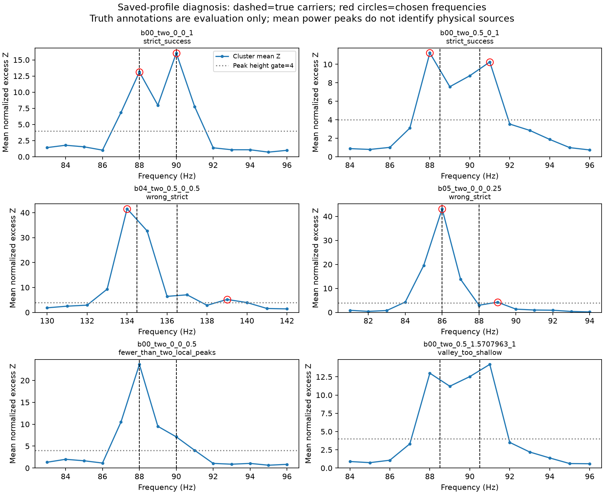
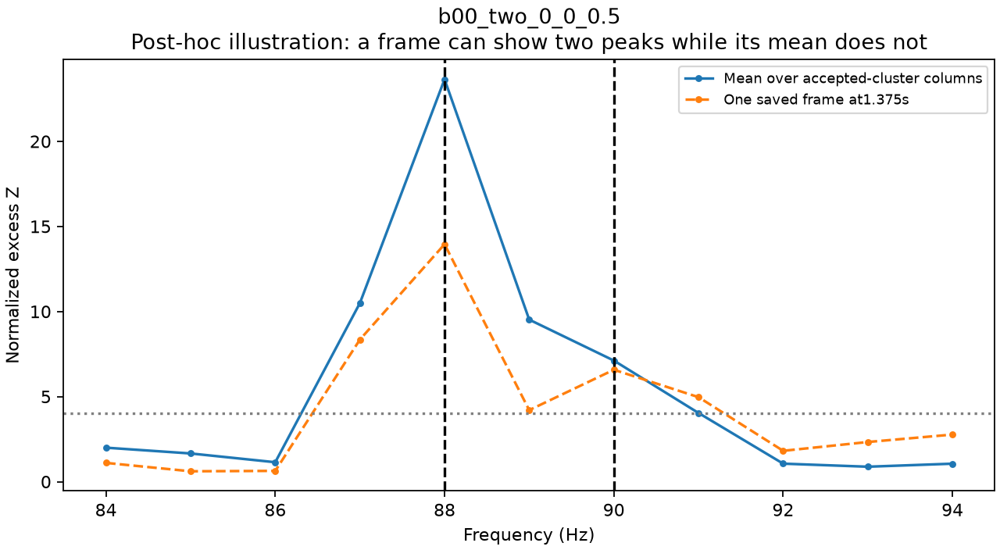

# Where the matched two-tone decisions succeeded and failed

28 November 2026. Retrospective saved-data diagnosis of W1D1, run20261128T115035Z_bf957291. No waveform generation, detector change, threshold fitting or retuning. All216two-tone records remain development evidence after inspection. Parent artifacts are unchanged. [Case-level JSON](diagnosis.json), [24correct pairs](correct_pairs.csv), [5wrong pairs](wrong_pairs.csv), [187no-pair cases](no_pair_cases.csv), [verification](verification.json).

## 1. The24strict successes

Conditions:12equal-amplitude/on-grid/phase0;4equal/on-grid/phase90;1equal/on-grid/phase180;3equal/off-grid/phase0;4ratio0.5/off-grid/phase0. Resultant root-energySNR18 and gap2Hz are fixed in all cases. The counts share12noise/carrier/global-phase base units; they are not24independent replications. Phase is defined at onset.

17pairs match both true carriers exactly (on-grid);7pairs have exactly0.5Hzerror for each carrier (off-grid). Their estimated separation need not equal2Hz: an off-grid pair can round outward to3Hz while both individual errors still meet0.5Hz. This is why individual frequency and separation errors must remain distinct.

Chosen mean-profile peak heights span6.6984..38.5241in normalized Z units, above the peak gate4. Between-peak valley/minimum-peak ratios span0.493017..0.790593: dips about20.94%..50.70%. The required dip is20%. Some examples are only slightly beyond that boundary; 'two local maxima' does not imply two universally clear physical sources. Peak prominence, exact heights, margins and boxes are retained per case.

| ID | Amplitude ratio | Phase(deg) | Grid offset(Hz) | True carriers(Hz) | Chosen(Hz) | Errors(Hz) | Peak heights | Valley/min peak |
| --- | ---: | ---: | ---: | --- | --- | --- | --- | ---: |
| b00_two_0_0_1 | 1 | 0 | 0 | [88.0, 90.0] | [88.0, 90.0] | [0.0, 0.0] | [13.124, 16.055] | 0.6079 |
| b00_two_0_1.5707963_1 | 1 | 90 | 0 | [88.0, 90.0] | [88.0, 90.0] | [0.0, 0.0] | [15.633, 15.159] | 0.7618 |
| b00_two_0.5_0_1 | 1 | 0 | 0.5 | [88.5, 90.5] | [88.0, 91.0] | [0.5, 0.5] | [11.229, 10.254] | 0.7388 |
| b01_two_0_0_1 | 1 | 0 | 0 | [90.0, 92.0] | [90.0, 92.0] | [0.0, 0.0] | [22.126, 14.947] | 0.7226 |
| b02_two_0_0_1 | 1 | 0 | 0 | [106.0, 108.0] | [106.0, 108.0] | [0.0, 0.0] | [17.384, 15.655] | 0.7339 |
| b03_two_0_0_1 | 1 | 0 | 0 | [168.0, 170.0] | [168.0, 170.0] | [0.0, 0.0] | [30.936, 29.48] | 0.6530 |
| b03_two_0.5_0_1 | 1 | 0 | 0.5 | [168.5, 170.5] | [168.0, 171.0] | [0.5, 0.5] | [22.265, 33.224] | 0.7230 |
| b03_two_0.5_0_0.5 | 0.5 | 0 | 0.5 | [168.5, 170.5] | [168.0, 171.0] | [0.5, 0.5] | [36.864, 16.719] | 0.6699 |
| b04_two_0_0_1 | 1 | 0 | 0 | [134.0, 136.0] | [134.0, 136.0] | [0.0, 0.0] | [27.458, 26.243] | 0.5218 |
| b05_two_0_0_1 | 1 | 0 | 0 | [86.0, 88.0] | [86.0, 88.0] | [0.0, 0.0] | [21.201, 14.7] | 0.5929 |
| b05_two_0_1.5707963_1 | 1 | 90 | 0 | [86.0, 88.0] | [86.0, 88.0] | [0.0, 0.0] | [27.587, 26.608] | 0.6220 |
| b05_two_0.5_0_0.5 | 0.5 | 0 | 0.5 | [86.5, 88.5] | [86.0, 89.0] | [0.5, 0.5] | [20.193, 9.433] | 0.7767 |
| b06_two_0_0_1 | 1 | 0 | 0 | [172.0, 174.0] | [172.0, 174.0] | [0.0, 0.0] | [24.475, 27.494] | 0.5759 |
| b06_two_0_1.5707963_1 | 1 | 90 | 0 | [172.0, 174.0] | [172.0, 174.0] | [0.0, 0.0] | [32.246, 33.543] | 0.7008 |
| b06_two_0_3.1415927_1 | 1 | 180 | 0 | [172.0, 174.0] | [172.0, 174.0] | [0.0, 0.0] | [38.524, 38.311] | 0.7704 |
| b06_two_0.5_0_0.5 | 0.5 | 0 | 0.5 | [172.5, 174.5] | [172.0, 175.0] | [0.5, 0.5] | [34.138, 14.351] | 0.7330 |
| b07_two_0_0_1 | 1 | 0 | 0 | [110.0, 112.0] | [110.0, 112.0] | [0.0, 0.0] | [26.85, 23.638] | 0.4930 |
| b07_two_0_1.5707963_1 | 1 | 90 | 0 | [110.0, 112.0] | [110.0, 112.0] | [0.0, 0.0] | [32.752, 29.872] | 0.6215 |
| b08_two_0_0_1 | 1 | 0 | 0 | [90.0, 92.0] | [90.0, 92.0] | [0.0, 0.0] | [14.084, 13.464] | 0.5267 |
| b08_two_0.5_0_1 | 1 | 0 | 0.5 | [90.5, 92.5] | [90.0, 93.0] | [0.5, 0.5] | [11.791, 15.382] | 0.7067 |
| b08_two_0.5_0_0.5 | 0.5 | 0 | 0.5 | [90.5, 92.5] | [90.0, 93.0] | [0.5, 0.5] | [18.694, 6.698] | 0.7306 |
| b09_two_0_0_1 | 1 | 0 | 0 | [102.0, 104.0] | [102.0, 104.0] | [0.0, 0.0] | [17.177, 30.229] | 0.7314 |
| b10_two_0_0_1 | 1 | 0 | 0 | [148.0, 150.0] | [148.0, 150.0] | [0.0, 0.0] | [23.237, 37.416] | 0.7906 |
| b11_two_0_0_1 | 1 | 0 | 0 | [98.0, 100.0] | [98.0, 100.0] | [0.0, 0.0] | [16.607, 24.745] | 0.6490 |

## 2. The5wrong claimed pairs

All5fail the strict<=0.5Hz rule. Four also fail<=1Hz; one passes that looser rule. They are wrong FREQUENCY estimates on genuine two-tone inputs, distinct from false two-tone claims on one-tone/noise controls.

| ID | True carriers | Chosen frequencies | Errors | Weak/strong amplitude | Relative phase(deg) |
| --- | --- | --- | --- | ---: | ---: |
| b04_two_0.5_0_0.5 | [134.5, 136.5] | [134.0, 139.0] | [0.5, 2.5] | 0.5 | 0 |
| b04_two_0.5_0_0.25 | [134.5, 136.5] | [134.0, 139.0] | [0.5, 2.5] | 0.25 | 0 |
| b04_two_0.5_1.5707963_0.5 | [134.5, 136.5] | [134.0, 139.0] | [0.5, 2.5] | 0.5 | 90 |
| b04_two_0.5_1.5707963_0.25 | [134.5, 136.5] | [134.0, 139.0] | [0.5, 2.5] | 0.25 | 90 |
| b05_two_0_0_0.25 | [86.0, 88.0] | [86.0, 89.0] | [0.0, 1.0] | 0.25 | 0 |

Four cases share base04and the exact same noise, carriers134.5/136.5Hz and offset0.5Hz. The estimator chooses134/139Hz. First error0.5Hz, second2.5Hz: it selects a nearby extraneous spectral peak, not a wildly remote frequency and not simply nearest-bin rounding of136.5. These four variants are correlated failures, not four independent noise mechanisms.

At139Hz the same-column noise-only mean profiles already have a local maximum with Zabout3.39..3.65; in the two-tone profiles it is4.35..5.19. Raw-power decomposition of the saved complex STFT confirms nonzero noise, added-signal leakage and interference contributions; this is NOT a pure-noise-only power feature. The decomposition is algebra on saved transforms, not a new noise-free experiment. Difference-of-STFT includes preprocessing differences at very low frequencies; selected bins134/139are unaffected by median DC removal for the Hann representation.

Concrete base04/ratio0.5/phase0: accepted long-cluster frequency box expands from128.5..136.5Hz in the single-tone control to128.5..140.5Hz in the two-tone input. This brings139Hz inside the diagnostic search extent. The single-tone control can have a139Hzmaximum in the same columns but does not claim a pair: it is outside that control’s accepted cluster box. Noise alone has no accepted cluster. Thus zero control claims does not rule out this failure after a real second tone expands the accepted component.

In THAT particular ratio0.5/phase0case there is also a closer137Hzpeak: mean heights at134/137/139are41.55/7.05/5.19. Pair134/137fails the valley criterion (ratio0.911>0.8);134/139passes (0.546). The rule therefore prefers an extraneous but more deeply separated peak. In the OTHER THREE base04wrong cases,137Hzdoes not appear as a qualifying local maximum; do not generalize the three-way competition to all four.

The fifth case is base05,truth86/88Hz,chosen86/89Hz. It misses the weaker tone by1Hz, so passes the old loose tolerance but fails strict0.5Hz. Its weak chosen peak is only4.2586,just above4. Across all5errors, the weaker selected height is4.2586..5.1889, versus at least6.6984for the successful pairs. This separation is post-hoc evidence, not permission to raise the threshold on the same data and call it independently validated. False pairs can have deeper valleys than correct ones; valley depth alone is not reliability.

## 3. The187no-pair cases: exclusive algorithmic stopping points

All187have an available anomaly decision and an accepted long-scale cluster. None is lost at calibration availability, anomaly significance, final pair-score cutoff or frequency-box disjointness: W1D1 permits peaks within one box. The first-failed-gate classification is per observation; a second component is not required to be a separate cluster.

| First failing condition in the cluster mean spectrum | Cases | Meaning |
| --- | ---: | --- |
| Fewer than2local maxima inside an accepted cluster extent | 141 | No separate second maximum in that averaged representation; a shoulder can still be present. |
| At least2maxima exist, but fewer than2reach Z>=4 | 8 | The second candidate maximum is too weak for this fixed rule. |
| Two sufficiently high, spaced maxima exist, but every pair has valley >0.8*smaller peak | 38 | The rule rejects a shallow dip, even if both maxima exist. |
| No interior frequency sample between peaks | 0 | Not an observed failure; strict local maxima are already separated by at least one intervening bin. |
| Later pair cutoff / other rejection | 0 | No eligible proposals are discarded at a later step. |

These categories describe the implemented mean-profile pipeline. They do not prove that an observable second oscillation never existed in the waveform, or identify which upstream STFT/normalization choice caused a merged average.

## 4. Information can appear in individual frames and disappear in the average

For each saved cluster, the diagnostic averages normalized power over its occupied time columns. We inspected those SAMEcolumns and used true carriers only afterward to annotate peaks within+/-0.5Hz; this evaluation knowledge never entered the original decision.

Among the141mean-spectrum cases with fewer than2local maxima,100have at least one event-time frame containing two carrier-associated peaks inside the accepted frequency box that satisfy height, spacing AND valley gates on that single frame. The average has fewer than2local maxima nonetheless.105/141have two local carrier-associated maxima inside the box at some frame;103have both above4. Thus temporal averaging is a concrete stage at which potentially useful peak morphology can disappear in these records. It is not correct to say all141had no double-peak structure anywhere in time.

Across all187no-pair cases,140have at least one such individually qualifying frame; the remaining47lack that particular annotated frame evidence. Transient-frame scanning makes many opportunities to find coincidental peaks, especially when annotated with known carrier frequencies. No corresponding frame-scanning false-positive calibration was performed here. It is therefore a diagnostic observation, NOT a ready improved detector or an established success rate for a new method.

Raw-power and normalized-frame annotations are retained separately.150/187show a carrier-associated double maximum in at least one raw-power frame and150in a normalized frame; matching totals do not prove identical frames or no normalization effect. Mean-profile full-spectrum/inside-box carrier-pair evidence is35/187. The case-level records preserve counts/times so that averaging, box restriction and peak gates are not conflated.

## Verification, interpretation and preservation

216mean-profile reconstructions agree with the stored profiles; reconstructed valid-pair gates agree with all29claims and187abstentions. The three rejection categories sum exactly187.24strict and5wrong identities match the parent evaluations. Ten selected-bin raw power identities were checked against saved complex transforms for the wrong-control comparisons. Parent artifact hashes remain unchanged. Figures visually inspected. No scientific rerun, retuning, exclusions, O3, production change, commit or push.

A possible next question is whether a truth-blind, temporally persistent multi-peak diagnostic can preserve this information WITHOUT adding one-tone/noise false pairs. It would need predeclared timing/persistence rules, independent calibration and new negative controls; maximizing over frames on the current examples is not validation. Keep this diagnosis as development evidence.

