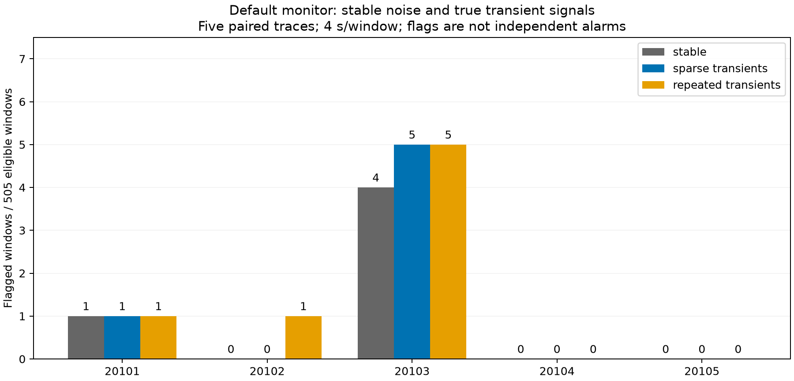
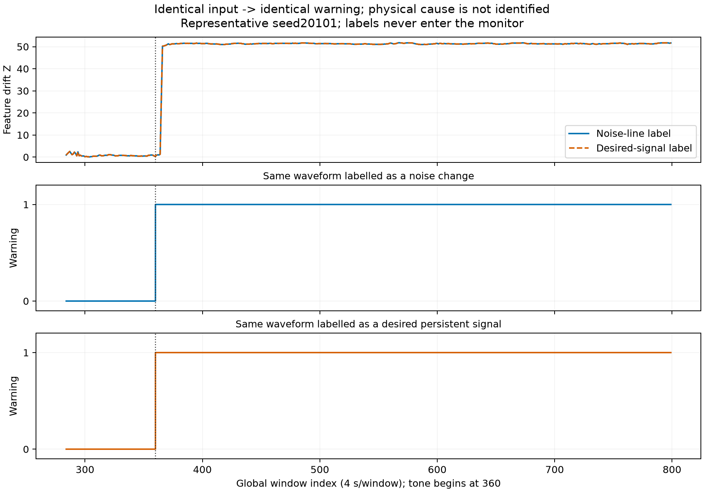

# Warning-only regime monitor: frozen-default independent sequence pilot

Run `20261127T173116Z_9d6affa3`, source6f4ccfa. [Pre-run protocol](protocol.md), [independent numerical checks](independent_verification.json), [counts](summary_counts.csv).

## What was tested

ONE existing BackgroundRegimeMonitor with its unchanged default causal configuration:12window local history,KSalpha0.005,medianZ3.5,CUSUMk0.75,h12 and internal offset1.8; no tuning, debounce, reference resets or added classifier. Five fresh seed traces,800four-second observations each, six paired cases:stable,levelstep,line,sparse/repeatedtransients,and a persistent desired signal exactly identical to the line case. Five seeds are the independent sequence units; cases and windows are paired/correlated.

Initial284observations freeze the reference and a separate core search calibration (85A/199B,FAP0.005). Targets284..799 provide516decisions. Monitorwarmup284..294 contains11unassessedwindows; firstfull12-windowresult295 is available at its end1184s,48saftertargetstart. The API4slatency field is an observation duration, not a claim of4sfull-history startup.

Core search outputs and candidate arrays remain unchanged. The warning sidecar stores exact search-record hashes, never suppresses a candidate or gates exposure and never updates background. The hypothetical losses below show what would happen under a gate, not an action performed here. SearchFAP and monitorKSalpha have different meanings despite the same numeric0.005.

## Descriptive fixed-horizon accounting

| Case | Sequences with any warning | Warning windows / eligible | Warning episodes | Extra / suppressed warning windows vs stable | Hypothetical lost search associations |
| --- | ---: | ---: | ---: | ---: | ---: |
| stable | 2/5 | 5/2525 | 4 | 0 / 0 | 0/0 |
| level_step | 5/5 | 2203/2525 | 7 | 2198 / 0 | 0/0 |
| spectral_line | 5/5 | 2203/2525 | 7 | 2198 / 0 | 0/0 |
| sparse_transients | 2/5 | 6/2525 | 5 | 1 / 0 | 2/47 |
| repeated_transients | 3/5 | 7/2525 | 6 | 4 / 2 | 2/304 |
| persistent_signal | 5/5 | 2203/2525 | 7 | 2198 / 0 | 2200/2200 |

Warning windows in a continuous episode are NOT separate new alarms. The stable count is false warning relative to this unchanged synthetic noise law. Signal-associated warnings indicate altered measurements, not proof of instrumental noise or a false physical signal. Persistent-signal window counts represent one sustained episode per seed, not hundreds of independent signals.

### True-change latency

| Case | Seed | Warning active before change | First post-change flag delay(s) | First NEW episode delay(s) |
| --- | ---: | --- | ---: | ---: |
| level_step | 20101 | False | 4.0 | 4.0 |
| spectral_line | 20101 | False | 4.0 | 4.0 |
| level_step | 20102 | False | 4.0 | 4.0 |
| spectral_line | 20102 | False | 4.0 | 4.0 |
| level_step | 20103 | False | 4.0 | 4.0 |
| spectral_line | 20103 | False | 4.0 | 4.0 |
| level_step | 20104 | False | 4.0 | 4.0 |
| spectral_line | 20104 | False | 4.0 | 4.0 |
| level_step | 20105 | False | 4.0 | 4.0 |
| spectral_line | 20105 | False | 4.0 | 4.0 |

A same-window warning has4snotification delay measured from changeSTART to assessmentEND. This is observation-window timing, not a measured live-computation runtime guarantee. Already active false warnings are not credited as new detection. Null means no observed qualifying episode, not zero latency.

## Fixed exploratory gates

- `zero_stable_warning_episodes`: False.
- `all_changes_new_episode_within_48s_without_preexisting_warning`: True.
- `zero_extra_transient_warning_windows`: False.

These strict pilot desiderata were fixed before outcomes. Even allpassing would not validate long-horizon false-warning control or deployment; failures are retained, not used to retune defaults on this sample. No formal superiority or pooled-binomial inference was performed.

## Signal and noise ambiguity

A supplemental saved-output comparison found exact equality of all2580stable-versus-level-step search scores,p-values and nomination decisions, even though the monitor strongly warns about the gain step. In this constructed factor-two case the local normalization removes its effect on the search statistic. This does not prove general invariance to arbitrary instrument changes, but shows why a warning alone should not automatically invalidate search decisions. See gain_invariance_diagnostic.json.

The spectral-line and persistent-signal cases have exactly identical inputs, reference, core scores/candidates and warnings. Only evaluation labels differ; support-association fields can differ because those use truth outside the algorithm. The monitor cannot determine which causal label is correct from these identical observations. This is an intentionally constructed ambiguity, not discovery of a new impossibility theorem or a real-event explanation.

A generic warning can still be useful: a frozen reference may not describe the current measurements. It cannot authorize treating a persistent feature as noise, deleting it or fitting a new background to it. High apparent search recovery on a persistent line must be read beside its noise-case alarms. No claim that line warnings identify instrumental origin, and no GW170814/H1 causal inference.

Sparse/repeated-transient cases share the same underlying stable noise. Extra warning windows and hypothetical lost recovered injections expose confounding, including warnings on nearby noise windows through local history/CUSUM. This pilot uses only two families atSNR18; absence of a conflict in a seed does not certify all signals.

## Numerical verification and preservation

Checks pass5frozen reference models,5search calibrations,15480monitor records,15480search records,53711candidate records and15480sidecar hashes. Regenerated24000input-window records;105manualHann/NumPyFFTfeature checks and90productionprefix comparisons. The KSoracle independently checks90900local/referencefeature comparisons via exactintegerpath counting; maxBonferronipdifference9.99e-16. This checks numerical arithmetic under the KSmodel, not its statistical validity for dependent windows. The integer oracle also matches32small-boundary exhaustive null-path enumerations (ks_oracle_enumeration_checks.json).

Reference medians/MADfallbacks,localZ,CUSUM,KSstatistic/p,allflags/episodes,signaloverlap,corecalibration/empiricalp/strictacceptance,candidate standardization/bounds/supportassociation and unchanged warning annotation verified. Prefix lengths12/76/96 and pairedcase identities provide scoped causality/label-blindness evidence, not a formal proof for every possible input.

No production/app/test changes, background update, candidate suppression, excluded case, measurement interruption, retuning, O3/data/manifest/network or real-waveform access. Source/dependency/reference hashes unchanged. The pre-execution verifier syntax check caught a keyword/dictionary typo; retained in verification_preparation_error.json and corrected before verification without restarting measurements. These counts are scoped research checks, not full-suite pytest passes or scientific correctness proof.

## Limits and decision

**Pre-run protocol inconsistency:** the two transient schedules were required both to alternate families within each case and to share identical injections on shared indices. These requirements conflict at344,704,784. The implementation follows the explicit within-case alternation; those three shared positions use different families, while underlying noise remains identical. Preserve the original protocol and outputs; see protocol_inconsistency.json. Each case versus stable remains interpretable, but differences between sparse and repeated cases are not a pure cadence intervention. No rerun or parameter change was used to hide this issue.

This fixed34.4min target horizon has only five seed replications and two chosen noise changes. The existing per-feature Bonferroni correction does not control repeated-time warnings over an arbitrary deployment. JointFFTcolored noise, finite reference variation and limited signal families remain. No automatic reference replacement, expiry policy, validated monitorFAP, Union repair or real source-purity validation was tested. L09/L10 remain open.

Keep this monitor as an explicitly provisional diagnostic sidecar. Do not adopt its warnings as noise-origin labels or automatic gates/recalibration triggers. Any redesigned rule needs a newly frozen protocol, independent sequences, a declared warning/latency budget and retained persistent-signal ambiguity. Do not optimize the thresholds on this failed/passing pilot until a desirable score appears.

All five seeds shown; these are flagged-window counts, not independent alarms or FAP estimates.

Representative firstseed20101; full five-seed waveform/core/monitor identity checked. Labels are evaluation-only.
