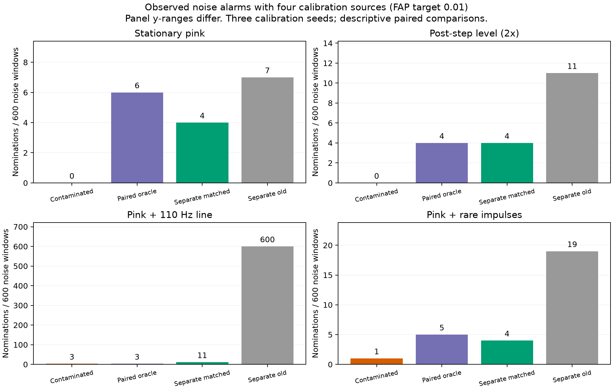
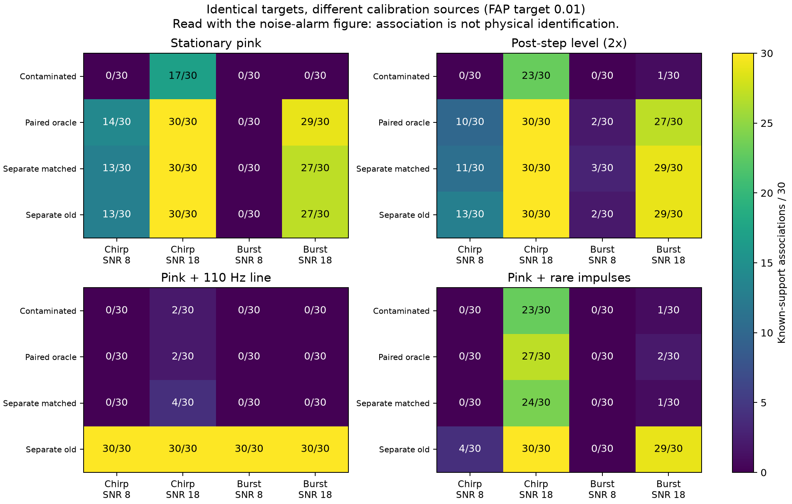

# Separately acquired background: source-control pilot

Run `20261127T154355Z_4f134945`, source d049e2b; unchanged detector core. [Protocol](protocol.md), [independent verification](independent_verification.json), [counts CSV](comparison_counts.csv).

## Design and scope

Three fresh seeds18101..18103, four noise profiles, four265-window background sources, FAP0.01/0.005. Each source has66normalizationA/199thresholdB. All eight calibrations per seed/profile frozen before target decisions; all targets identical across arms. No tail filtering or quarantine. Every calibration is available at both FAPs; there are no abstentions in this pilot.

Stream_contaminated adds two chirps/two bursts at indices100/140/180/220 inB. Paired_noise_oracle is exactly that background before those additions; inaccessible in real measurements. Separate_matched is a fresh independently sampled, signal-free background from the same generated noise law as the target. Separate_old is another independent stationary pink draw, intentionally mismatched in the other profiles. Signal-free matching is guaranteed by the synthetic construction, NOT discovered by an admission rule.

The paired oracle shares allA and differs in exactly fourB inputs. Separate_matched replacesA/B and therefore includes ordinary calibration-sampling variation; differences from oracle are not evidence of a second physical mechanism. Level_step is a fixed post-step snapshot (2xnoise), not a test of transition timing, continuous drift or automatic adaptation.

Each profile has600negative windows across three calibration draws,2400available seconds per arm, and30units per fixed family/SNR (120paired-amplitude signal records,60distinct noise/clean units). Across profiles,240distinct signal units/480amplitude records. Arms and FAPs reuse targets; paired amplitudes share noise. Do not count repetitions as independent samples. Support association means accepted rectangle intersects the known signal time/frequency rectangle; it is weaker than waveform identification.

## Results

Counts below are descriptive aggregates over three calibration seeds, not a pooled independent-binomial FAR guarantee or a formal superiority test. Read association counts beside noise alarms: a mismatched background may nominate noise and produce misleading apparent recovery.

### FAP target 0.01

| Noise profile | Calibration source | Noise alarms / 600 | Chirp SNR8 / 30 | Chirp SNR18 / 30 | Burst SNR8 / 30 | Burst SNR18 / 30 |
| --- | --- | ---: | ---: | ---: | ---: | ---: |
| stationary | stream_contaminated | 0 | 0 | 17 | 0 | 0 |
| stationary | paired_noise_oracle | 6 | 14 | 30 | 0 | 29 |
| stationary | separate_matched | 4 | 13 | 30 | 0 | 27 |
| stationary | separate_old | 7 | 13 | 30 | 0 | 27 |
| level_step | stream_contaminated | 0 | 0 | 23 | 0 | 1 |
| level_step | paired_noise_oracle | 4 | 10 | 30 | 2 | 27 |
| level_step | separate_matched | 4 | 11 | 30 | 3 | 29 |
| level_step | separate_old | 11 | 13 | 30 | 2 | 29 |
| spectral_line | stream_contaminated | 3 | 0 | 2 | 0 | 0 |
| spectral_line | paired_noise_oracle | 3 | 0 | 2 | 0 | 0 |
| spectral_line | separate_matched | 11 | 0 | 4 | 0 | 0 |
| spectral_line | separate_old | 600 | 30 | 30 | 30 | 30 |
| impulsive_noise | stream_contaminated | 1 | 0 | 23 | 0 | 1 |
| impulsive_noise | paired_noise_oracle | 5 | 0 | 27 | 0 | 2 |
| impulsive_noise | separate_matched | 4 | 0 | 24 | 0 | 1 |
| impulsive_noise | separate_old | 19 | 4 | 30 | 0 | 29 |

### FAP target 0.005

| Noise profile | Calibration source | Noise alarms / 600 | Chirp SNR8 / 30 | Chirp SNR18 / 30 | Burst SNR8 / 30 | Burst SNR18 / 30 |
| --- | --- | ---: | ---: | ---: | ---: | ---: |
| stationary | stream_contaminated | 0 | 0 | 12 | 0 | 0 |
| stationary | paired_noise_oracle | 5 | 14 | 30 | 0 | 29 |
| stationary | separate_matched | 2 | 11 | 30 | 0 | 25 |
| stationary | separate_old | 6 | 12 | 30 | 0 | 26 |
| level_step | stream_contaminated | 0 | 0 | 15 | 0 | 0 |
| level_step | paired_noise_oracle | 2 | 6 | 30 | 1 | 25 |
| level_step | separate_matched | 1 | 9 | 30 | 2 | 27 |
| level_step | separate_old | 9 | 13 | 30 | 2 | 29 |
| spectral_line | stream_contaminated | 1 | 0 | 0 | 0 | 0 |
| spectral_line | paired_noise_oracle | 1 | 0 | 0 | 0 | 0 |
| spectral_line | separate_matched | 10 | 0 | 4 | 0 | 0 |
| spectral_line | separate_old | 600 | 30 | 30 | 30 | 30 |
| impulsive_noise | stream_contaminated | 0 | 0 | 9 | 0 | 0 |
| impulsive_noise | paired_noise_oracle | 1 | 0 | 26 | 0 | 2 |
| impulsive_noise | separate_matched | 2 | 0 | 23 | 0 | 1 |
| impulsive_noise | separate_old | 15 | 3 | 30 | 0 | 27 |

## Interpretation and limits

In stationary pink noise, separate matched changes strong-chirp support associations17->30/30 and strong bursts0->27/30, while noise alarms rise0->4/600. In the post-step snapshot the corresponding counts are23->30 and1->29, with noise0->4/600. These are measured source effects on paired targets, not a demonstrated sensitivity gain at equal true false-alarm rate. Weak bursts remain poorly recovered; impulsive and line profiles retain severe limitations.

The old source in the level-step snapshot differs in waveform gain, but a gain change need not change a locally normalized detection statistic in the same way as a new spectral line. This pilot does not establish gain-induced failure from differences between three random calibration draws.

The deliberately old background in the line profile nominates 600/600noise windows at nominalFAP0.01. Its positive-window associations therefore cannot be interpreted as successful signal identification. A signal-free independent source is not enough if its noise distribution fails to match the target.

A separate matched source tests whether suitable independently acquired background can avoid signal contamination without selecting quiet tails or losing exposure. It is not an autonomous admission solution. Comparison with the oracle is diagnostic only; sample-to-sample normalization/threshold variation remains. Any claimed operational improvement still needs a common validated alarm budget, more independent calibration/sequence units and application-specific acquisition requirements.

This study does not establish that the chosen profiles represent a real sensor, that any real off-source segment is pure/stationary, or that a second channel can substitute for the target channel. Comparable preprocessing, gain, units, state and contamination risk must be justified for real background acquisition. No new astrophysical result, GW170814/H1 explanation, frozen broadband/Union repair or adaptive recovery inference.

## Independent verification and preservation

Checks pass: 96calibrations, 23040target/arm/FAP records, 22090candidate records, 15600regenerated calibration/target input records, and 180direct uncached raw-feature parity checks. Independent arithmetic reconstructsAstatistics,Bmaxima/ranks,nulls,alltargetscores/empiricalp/strictdecisions,candidate standardization/bounds/support association,paired gains/losses and actual exposure. Frozen hashes and input-source separation match. Generation replay proves preservation, not scientific validity or PRNG independence.

No measurement failures, interrupted runs, case exclusions, score trimming, parameter retuning or production edits. All original artifacts retained; source/dependency hashes unchanged. No O3/data/manifest/network or real-waveform access. These are scoped experiment checks, not full-suite pytest passes. The original detector remains default; L09/L10 stay unresolved.

Noise figure: panel y-ranges differ; denominators600perprofile/arm, same nominalFAP0.01, not equal achieved FAR.

Signal figure:30units per family/SNR/profile; amplitudes and arms paired. View alongside noise alarms.

## Next decision

Specify a realistic source-acquisition contract before attempting autonomous admission: what an instrument can record separately, what makes it comparable, what contamination information is externally available, when it is stale and when to abstain. A new sequence-level experiment must test mismatch, availability and actual recovery under a frozen protocol. Do not promote this oracle-backed synthetic pilot into operational certification.
