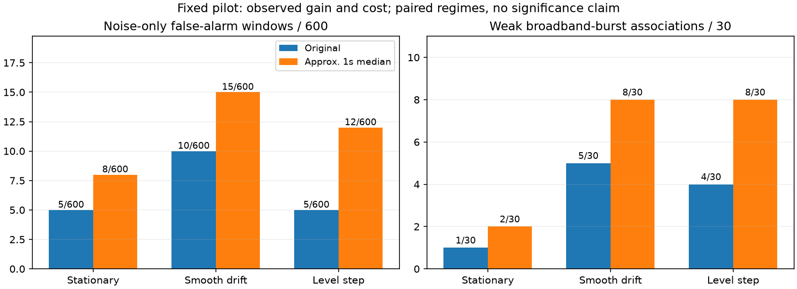
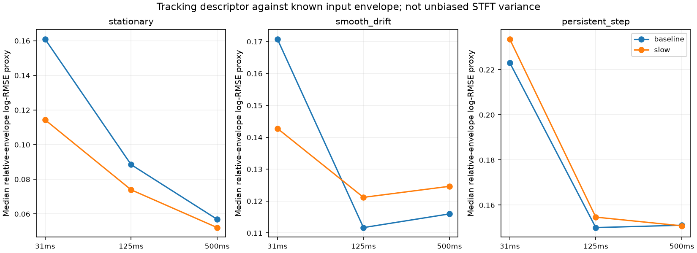

# Fixed temporal-envelope pilot: a measured sensitivity/noise trade-off

Run `20261127T101745Z_0fdf2942`; source `0cedef5dbc236864cd67f6e7f0027ed15c3f9d79`. [Protocol](protocol.md) specified before measurement. Both arms were separately calibrated. All measured cases completed without parameter changes, interruption or measurement failures. The new method remains a research prototype; no production detector or Workstation implementation was changed.

## One fixed change

The original temporal median kernels31/15/7frames become257/33/9frames at the same STFT hops. This is an approximately one-second centered smoother, with nominal k*hop widths1.00390625/1.03125/1.125s. Local spectral estimation, all STFT settings, strict Z>4, original eight-neighbor connectivity and two-cell minimum remain unchanged. The earlier gap-link prototype is not used. The estimator uses only the current observation, with future frames inside its four-second window; it is not a causal online estimator. Noise-only partners are used only for evaluation.

Focused controls check exact kernels, odd-frame clipping, finite/positive behavior, invalid inputs, constant and ideal monotonic-step preservation, short-spike rejection, wide-spike retention, strict seed boundary, original connectivity and direct fixed-map equations at all three scales. A longer median does not imply a universal fixed delay for every ideal step.

## Synthetic results: modest gains accompanied by more noise nominations

Each seed9101/9102/9103 has320 independent stationary calibration windows per arm (96normalization/224threshold), with nominalFAP.01. Evaluation uses the same200negative bases per seed transformed into stationary, smooth-drift and persistent-step regimes. Each regime contains600negative records and30injections per family/amplitude across the three calibrations. The same60distinct injection base/clean realizations are reused across regimes and amplitudes, producing360dependent mixtures; do not count them as360 independent examples.

| Noise regime | Quantity | Baseline | Approx.1s median | Slow-only / baseline-only paired decisions |
| --- | --- | ---: | ---: | --- |
| stationary | Noise-only alarms | 5/600 | 8/600 | 5 / 2 |
| stationary | Chirp SNR8 association | 19/30 | 21/30 | 2 / 0 |
| stationary | Broadband burst SNR8 association | 1/30 | 2/30 | 1 / 0 |
| stationary | Chirp SNR18 association | 30/30 | 30/30 | 0 / 0 |
| stationary | Broadband burst SNR18 association | 30/30 | 30/30 | 0 / 0 |
| smooth_drift | Noise-only alarms | 10/600 | 15/600 | 8 / 3 |
| smooth_drift | Chirp SNR8 association | 18/30 | 20/30 | 2 / 0 |
| smooth_drift | Broadband burst SNR8 association | 5/30 | 8/30 | 3 / 0 |
| smooth_drift | Chirp SNR18 association | 30/30 | 30/30 | 0 / 0 |
| smooth_drift | Broadband burst SNR18 association | 26/30 | 30/30 | 4 / 0 |
| persistent_step | Noise-only alarms | 5/600 | 12/600 | 9 / 2 |
| persistent_step | Chirp SNR8 association | 21/30 | 22/30 | 2 / 1 |
| persistent_step | Broadband burst SNR8 association | 4/30 | 8/30 | 4 / 0 |
| persistent_step | Chirp SNR18 association | 30/30 | 30/30 | 0 / 0 |
| persistent_step | Broadband burst SNR18 association | 29/30 | 30/30 | 1 / 0 |

Counts are descriptive. Different panels have different denominators and vertical ranges. The figure focuses on the weak broadband-burst hypothesis; the table retains both families and amplitudes. Known-support association is the predefined time/frequency rectangle-overlap evaluation rule, not proof that every credited component consists solely of injected signal. Whole-window nominations are exported separately. No synthetic veto/Workstation/adaptive/Union claim is made.

The new method gains a few weak chirp/burst associations and recovers all strong bursts in these stress cohorts, while noise-only counts increase in all three regimes. It is not a uniform per-case improvement: the persistent-step chirpSNR8 group includes one baseline-only recovery and two slow-only recoveries (net21->22). All misses and discordances remain saved. Small counts under three shared calibrations do not establish a statistically significant or population-wide improvement/degradation.

The stationary-calibrated thresholds are frozen during drift/step evaluation. Those cohorts are intentional out-of-distribution stress tests, not demonstrations of guaranteed1%FAP. Do not pool regimes/calibrations into a common-rate confidence interval. Positive root-energy SNR is defined using whole-window noise std; local SNR varies with the amplitude envelope. The same underlying bases are paired across regimes, so conditions are dependent. These fresh seeds/families must not be compared with older pilot totals as a version improvement.

## What changed in the normalizer itself

Below are stationary SNR18 paired mixture/noise median temporal-factor ratios. Each arm uses only its own observation during detection; the noise partner is accessed only after raw extraction for these diagnostics.

| Family | Scale | Baseline median T_mix/T_noise | Approx.1s median |
| --- | --- | ---: | ---: |
| linear_chirp | short_31ms | 1.251113 | 1.073304 |
| linear_chirp | medium_125ms | 1.086977 | 1.033328 |
| linear_chirp | long_500ms | 1.101278 | 1.035454 |
| band_limited_noise_burst | short_31ms | 2.165689 | 1.110063 |
| band_limited_noise_burst | medium_125ms | 1.488705 | 1.055841 |
| band_limited_noise_burst | long_500ms | 1.079647 | 1.038942 |

For the stationary broadband burst at SNR18, the short-scale median response drops from2.165689 to1.110063. Thus the intended reduction in signal-induced temporal normalization is measured on the same inputs. It does not mean a corresponding percentage gain in detection probability, nor eliminate spectral self-normalization. Complete min/max, increases/decreases and all regime/amplitude groups remain in paired_response_summary.json and per-record exports.

## Noise tracking is not one scalar success criterion

The tracking proxy is relative-envelope log-RMSE against the known input amplitude squared at STFT time centers, after median normalization. It is a descriptor, not an unbiased expected STFT variance for colored noise: finite support, correlation and edges matter. Panels have independent vertical ranges; compare numbers rather than visual curve heights.

| Regime | Scale | Baseline median proxy error | Approx.1s median |
| --- | --- | ---: | ---: |
| stationary | short_31ms | 0.160925 | 0.114322 |
| stationary | medium_125ms | 0.088439 | 0.073904 |
| stationary | long_500ms | 0.056848 | 0.052086 |
| smooth_drift | short_31ms | 0.170775 | 0.142763 |
| smooth_drift | medium_125ms | 0.111675 | 0.121155 |
| smooth_drift | long_500ms | 0.115970 | 0.124621 |
| persistent_step | short_31ms | 0.223094 | 0.233533 |
| persistent_step | medium_125ms | 0.150010 | 0.154644 |
| persistent_step | long_500ms | 0.151059 | 0.150792 |

Stationary proxy errors decrease at all scales. Smooth-drift behavior is mixed: short-scale error decreases while medium/long increase. Step errors increase at short/medium scales and are nearly unchanged at long scale. Lower typical proxy error does not imply better tail/cluster false-alarm control; the observed negative-control decisions remain the relevant cost measure. No frames are treated as independent trials.

## Developmental GW170814 replay

| Site | Arm | Near score / own threshold | Window empirical p | Associated raw / post-veto | Off-source raw / post-veto / windows |
| --- | --- | --- | ---: | --- | --- |
| H1 | baseline | 1.144807 / 2.590544 | 0.10887097 | False / False | 2 / 1 / 151 |
| H1 | slow | 2.612768 / 3.160593 | 0.01411290 | False / False | 1 / 0 / 151 |
| L1 | baseline | 8.892396 / 2.240084 | 0.00201613 | True / True | 3 / 3 / 151 |
| L1 | slow | 9.857507 / 2.503115 | 0.00201613 | True / True | 2 / 2 / 151 |

H1 remains a miss; L1 remains detected and survives vetoes. The H1 associated short-scale winner retains peaklocal1.53125s/160Hz, within the original loose association gate. Its component grows20->43cells and raw score123.224760->252.836460 solely under the changed temporal-envelope rule on the same input/spectral map. Its OWN recalibrated raw boundary, however, grows192.181715->290.480625. Thus252.836must not be compared with the old192.182threshold as a recovery. The resulting empirical windowp7/496=.01411290 exceeds.01. This is not an astrophysical source probability or a reason to tune the threshold on this known event. Source identity of every added cell is not established.

This is a concrete software effect on cluster representation, but it does not establish that temporal normalization is the sole physical cause of H1 weakness. The same event time/peak association was explicitly checked; unlike the earlier V1 late-feature interpretation, this recorded H1 winner is not off-time under the parent gate.

Off-source post-veto nominations decrease H1 1->0 and L1 3->2 over151windows/site (604s core exposure). These real-data windows are not certified pure noise; zero observed nominations does not establish zero FAR. The epoch informed development and CalB follows the target: no independent real-data validation, online/adaptive recovery or new significance claim. No coincidence or time-slide analysis was run.

## Verification and preservation

Separate verification checked10calibrations,4960arm/window decisions,1931accepted candidates,3120synthetic input-regeneration records,10800negative tracking records and2160paired response records. The predefined subset yielded90independent manual-map arm checks,18tracking checks and72paired-factor checks. These are verification counts, not new pytest passes or independent scientific replications.

Baseline event scores/thresholds/p and off-source counts reproduce the parent. Both O2 files match their original hashes after the run. Production/parent sources and archived driver/helper/protocol hashes match. Strict JSON, complete calibrated raw features/nulls, candidate geometry/flags/vetoes, known supports, input/profile hashes and all outcomes are retained. Generated arrays stay in memory, original files outside Git. The verifier reads no original/derived waveform or O3 files. No unsuccessful case was removed.

Reproduce from repository root using experiments/run_temporal_envelope_pilot.py and experiments/verify_temporal_envelope_pilot.py <new-run-directory>, with recorded production hashes and local O2 files. A new run gets a fresh directory. The supplementary plot_tradeoff.py is standalone inside a result folder and refuses to overwrite an existing plot. Archived driver/helper copies are provenance; use repository entry points.

## Decision

Archive this single candidate as a measured trade-off, not a default replacement. It reduces the tested short-signal normalizer response and gains some associations, with more synthetic noise alarms and mixed tracking behavior; it does not recover H1. No automatic adoption is justified by this small pilot. A next study would need task-specific false-alarm tolerances, larger independent cases and a preregistered comparison at a common noise-alarm budget using separate threshold-selection/evaluation data. Do not choose a new kernel/threshold merely to make H1 pass.

Production source, Workstation, existing tests and unrelated article/CodeQL drafts remain untouched. Adaptive background-admission limitations L09/L10 and the deferred DNA-window hypothesis are separate. No main merge, release or Zenodo operation. Real-data attribution: GWOSC / LIGO Scientific Collaboration / Virgo Collaboration, CC BY4.0; [acknowledgement](https://gwosc.org/acknowledgement/). Project MIT does not supersede the data license.
