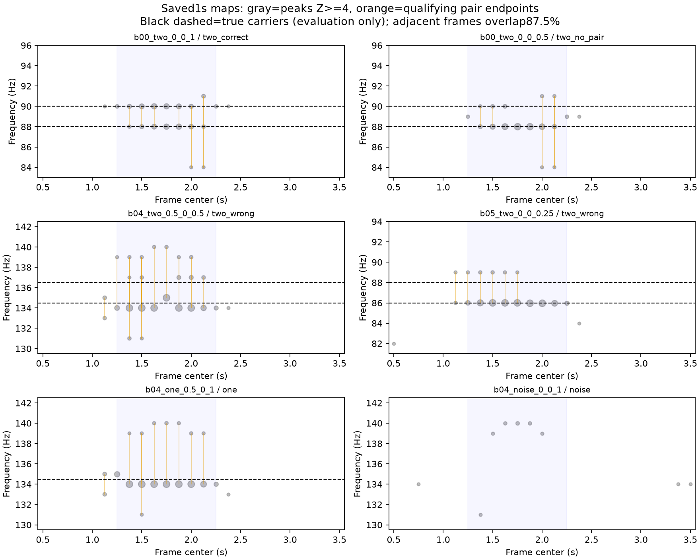
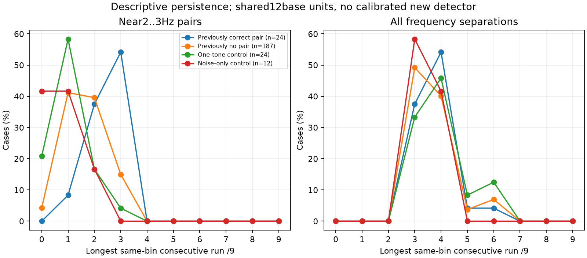

# Temporal persistence of saved spectral peak pairs

Run `20261128T135237Z_633a21cf`. [Protocol](protocol.md), [verification](independent_verification.json), [all case metrics](case_metrics.csv), [all frequency-pair counts](pair_frequencies.csv), [frame counts](frame_counts.csv).

## Scope and definitions

No detector changes, new waveforms, new maps, threshold fitting or classifier adoption. The252saved1-second maps comprise216two-tone variants,24matched singles and12matched noise controls, sharing12base noise/carrier/global-phase units. The320independent negative-control maps were not retained and are not included. All observations are now development evidence.

For each of25frames over the ENTIRE1..511Hz retained frequency range, find local maxima with normalized power Z>=4. A descriptive pair requires at least one intervening bin and a valley<=0.8*smaller peak. There is no accepted-cluster or anomaly gate. This prevents noise controls from appearing clean merely because the detector accepted no cluster. True frequencies enter annotations AFTER blind enumeration. These candidate structures are not newly asserted two-tone detections.

Two structural views are retained:all frequency separations,and near pairs2..3Hz apart anywhere on the map. Near is a predeclared morphology class, not truth-carrier knowledge. Tracks require consecutive frames with no gaps. Exact tracks repeat the same two frequency bins. Permissive tracks allow each sorted component to move<=1Hz per hop and select a retrospective longest path; branching can stitch alternatives,not establish physical identity.

Report full25frames and the SAMEcentral9frames1.25..2.25s in every group. The central interval matches the earlier event support but is only evaluation annotation; full blind enumeration does not use it. One-second Hann windows hop0.125s,overlap87.5%. A3-frame run spans0.25s between centers and1.25s of union window support. A5-frame run spans0.5s between centers and1.5s of union support. These are strongly dependent views of shared samples,not3or5independent confirmations.

## 1. Frequencies near the true carriers: evaluation-only description

This section uses the known two-tone carriers ONLY to annotate the already extracted pairs:one-to-one errors<=0.5Hz. It cannot be used as a blind selection rule.

| Original mean-spectrum group | Cases | Median qualifying central frames /9 (range) | At least one such frame | Same frequencies >=3frames | Allowing1Hzsteps >=3frames |
| --- | ---: | --- | ---: | ---: | ---: |
| Previously correct pair | 24 | 4 (2..6) | 24 | 13 | 13 |
| Previously wrong pair | 5 | 1 (0..4) | 4 | 0 | 0 |
| Previously no pair | 187 | 1 (0..6) | 140 | 24 | 28 |

Example true88/90Hz (base00,equal amplitudes,phase0,on-grid):the exact88/90pair appears in5of9central frames,but the longest uninterrupted run is3frames. With the same base and weaker/stronger ratio0.5 (the old mean-spectrum method returns no pair),88/90appears in2of9frames and holds2consecutive frames. Presence in several nonconsecutive frames is different from an uninterrupted stable pair.

In the24previously correct examples,carrier-associated pairs appear in2..6central frames,median4. Only13/24have a3-frame same-bin carrier-associated run. Thus requiring persistence would discard some original successes as well as retain evidence from previously unreturned cases.

In187previously unreturned cases,140have at least one carrier-associated qualifying frame;24have an exact3-frame run,28with allowed1Hzsteps. This is a post-hoc measurement of morphology,not28new calibrated detections or recovered sources.

## 2. Blind near-pair comparison with controls

The following table uses ANY2..3Hzpair over the full frequency axis,without true-frequency selection. A control pair may lie far from a single actual tone. All groups use identical gates and central9frame positions.

| Group | Cases | Median frames containing any near pair (range) | Exact run >=2 | Exact run >=3 | Exact run >=5 | Drift-allowed run >=3 |
| --- | ---: | --- | ---: | ---: | ---: | ---: |
| Previously correct pair | 24 | 5 (2..8) | 22 | 13 | 0 | 18 |
| Previously wrong pair | 5 | 4 (3..6) | 5 | 1 | 1 | 1 |
| Previously no pair | 187 | 3 (0..7) | 102 | 28 | 0 | 34 |
| One-tone control | 24 | 1 (0..3) | 5 | 1 | 0 | 1 |
| Noise-only control | 12 | 1 (0..3) | 2 | 0 | 0 | 0 |

Of24single-tone controls,19show at least one blind near-pair frame;one has a3-frame same-bin run. Of12noise controls,7show at least one near-pair frame,two have2-frame exact runs,none3-frame in this small sample. These are candidate patterns,not false-positive rates of a calibrated new detector. The controls share12bases and cannot validate a low-error operating rule.

For single-tone controls,post-hoc anchoring one peak to the actual single carrier leaves7/24with at least one near pair;one has a3-frame exact run. Thus the near-pair pattern need not be just an unrelated remote feature:even a known single tone can acquire a nearby spectral partner.

## 3. Do not hide the full-separation search

If any frequency separation is allowed,EVERYrecord has a3-frame exact pair somewhere in the central interval,including12/12noise-only maps. One-tone controls have5/24exact runs>=5;noise-only has0/12exact>=5 but4/12permissive drift paths>=5. Unrestricted pair persistence is therefore not an automatic signature of two tones. Comparing truth-annotated signal tracks against only remote-noise exclusions would be misleading.

## 4. Jumping strongest peaks versus retrospective stable tracks

Per-frame strongest-pair selection can switch to unrelated carrier regions; the longest-path diagnostic instead explicitly favors continuity. Neither is physical source tracking. The same-bin and1Hz-drift results must not be combined into one reliability number.

| Group | Adjacent central near-pair strongest transitions | Transitions moving >1Hz in either component | Largest jump (Hz) |
| --- | ---: | ---: | ---: |
| Previously correct pair | 79 | 8 | 309 |
| Previously wrong pair | 11 | 3 | 131 |
| Previously no pair | 236 | 66 | 309 |
| One-tone control | 8 | 3 | 128 |
| Noise-only control | 3 | 1 | 66 |

Counts aggregate shared variants and are descriptive,not independent transition trials. Large jumps reflect selection of a DIFFERENT spectral pair,not evidence that an oscillator physically jumped hundreds ofHz. pair_frequencies.csv lists every exact pair and frame count; records.json.gz retains individual timestamps and paths,so stable frequencies and switches can be audited per case.

## 5. The previously wrong pairs can persist

| Wrong case | Previously returned frequencies | Two-tone pair frames /9; longest exact run | Same-base single-tone control | Same-base noise control |
| --- | --- | --- | --- | --- |
| b04_two_0.5_0_0.5 | [134.0, 139.0] | 5/9; 3 consecutive | 4/9; 2 consecutive | 0/9; 0 consecutive |
| b04_two_0.5_0_0.25 | [134.0, 139.0] | 5/9; 3 consecutive | 4/9; 2 consecutive | 0/9; 0 consecutive |
| b04_two_0.5_1.5707963_0.5 | [134.0, 139.0] | 2/9; 1 consecutive | 4/9; 2 consecutive | 0/9; 0 consecutive |
| b04_two_0.5_1.5707963_0.25 | [134.0, 139.0] | 3/9; 2 consecutive | 4/9; 2 consecutive | 0/9; 0 consecutive |
| b05_two_0_0_0.25 | [86.0, 89.0] | 5/9; 5 consecutive | 0/9; 0 consecutive | 0/9; 0 consecutive |

Base04wrong134/139pair can repeat3consecutive frames;the same pair also appears in4central frames in its single-tone control,with a2-frame run. The139Hzpeak alone reachesZ>=4in2central noise-control frames,while134Hzdoes not supply a qualifying companion there. This is consistent with the saved noise/leakage/interference explanation;pair persistence does not remove that ambiguity.

The wrong86/89pair (true86/88) is MOREpersistent:6consecutive full-map frames,5central frames. Yet the second frequency is1Hzwrong. A rule requiring3or5frames alone would keep this error;no persistence threshold is adopted from these results.

## Verification and preservation

Independent saved-map check PASS: 252maps,6300frames,205439retained pair-gate records,3024track recurrences. The recurrence oracle uses pair-coordinate distance matrices rather than the producer’s neighbor lookup. Path membership,frequency drift,run lengths,time arithmetic,strongest selection and parent hashes are checked. No waveform generation or method tuning.

The source maps,parent evaluation and529parent artifact hashes remain unchanged. Full lists,case/frequency/frame CSVs,central/full summaries,wrong-pair controls,protocol andscripts are saved separately. Figures are illustrative evaluations;true-carrier lines and display crops do not enter extraction. The320independent negative-control maps are absent,not silently regenerated or counted.

Any future temporally persistent detector needs a separate fixed decision rule,independent calibration,new negative-control evaluation and honest exposure accounting. This descriptive analysis does not certify three-frame acceptance,source reconstruction,music stem separation or a false-claim probability. New results local;no commit/push,production changes,O3,mainmerge,releaseorZenodo.

