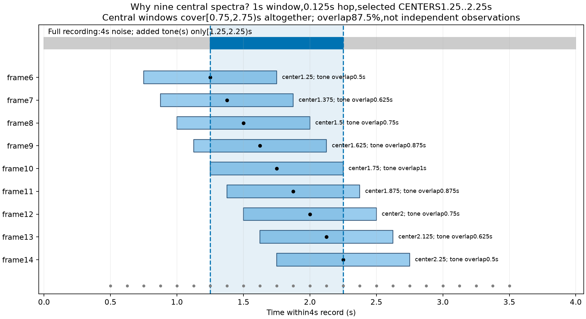
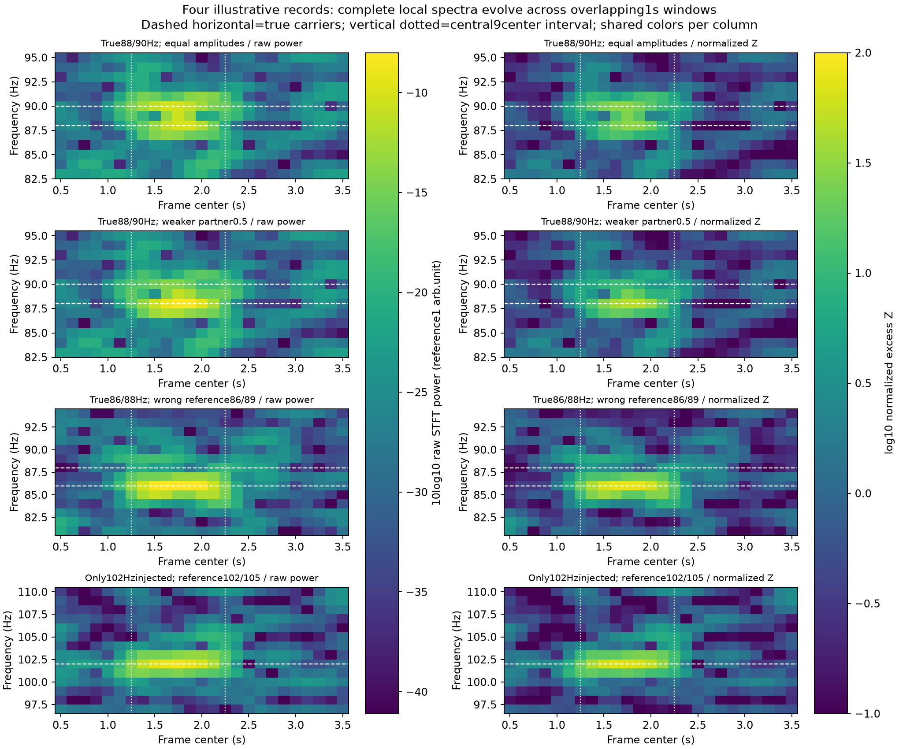
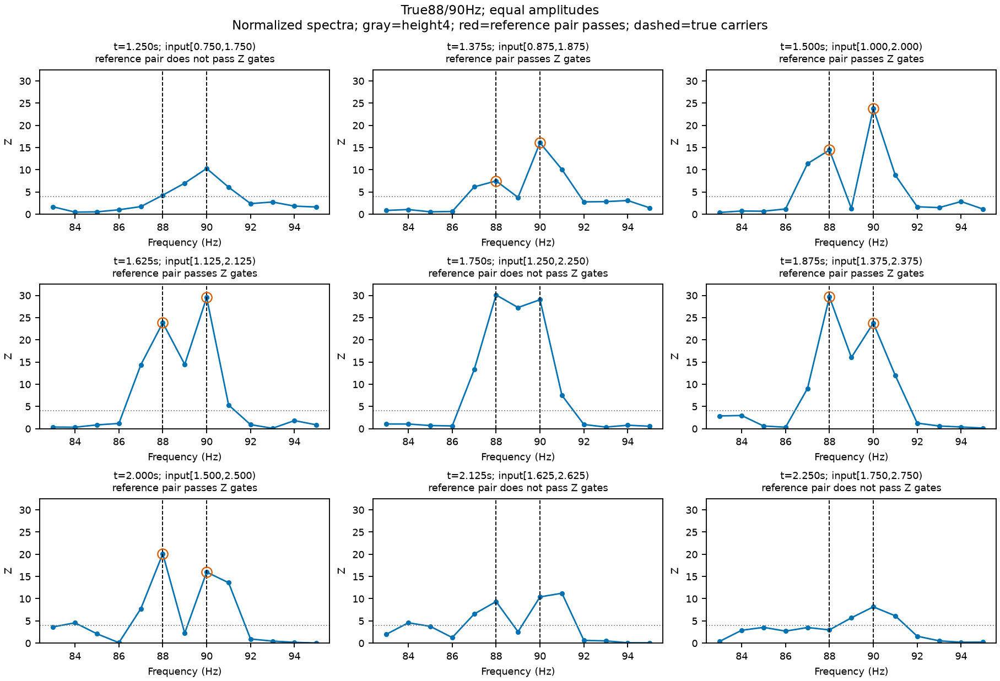
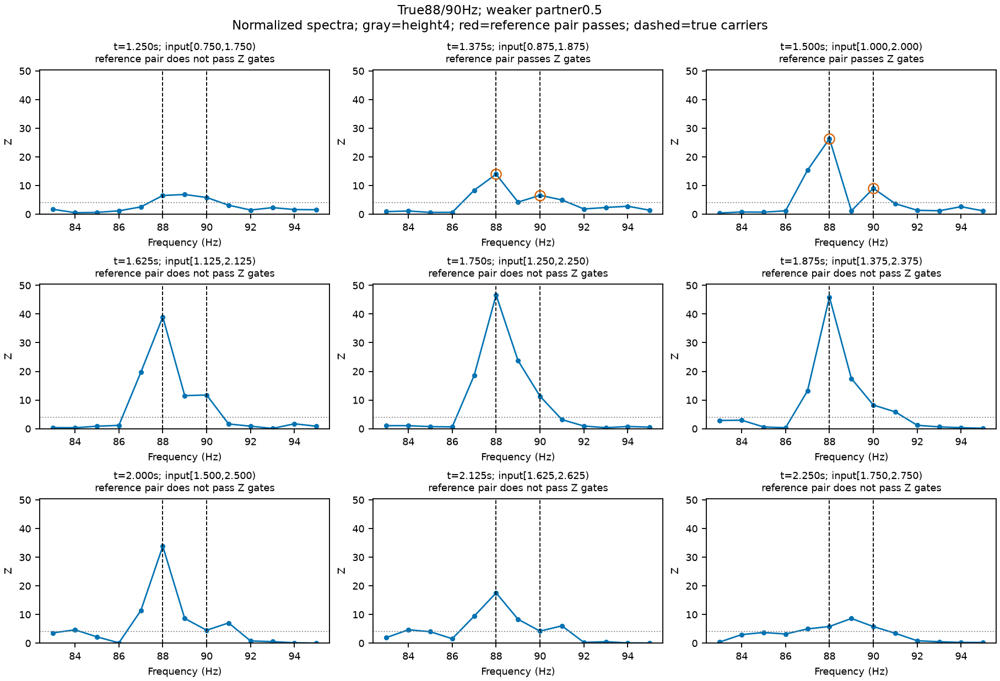
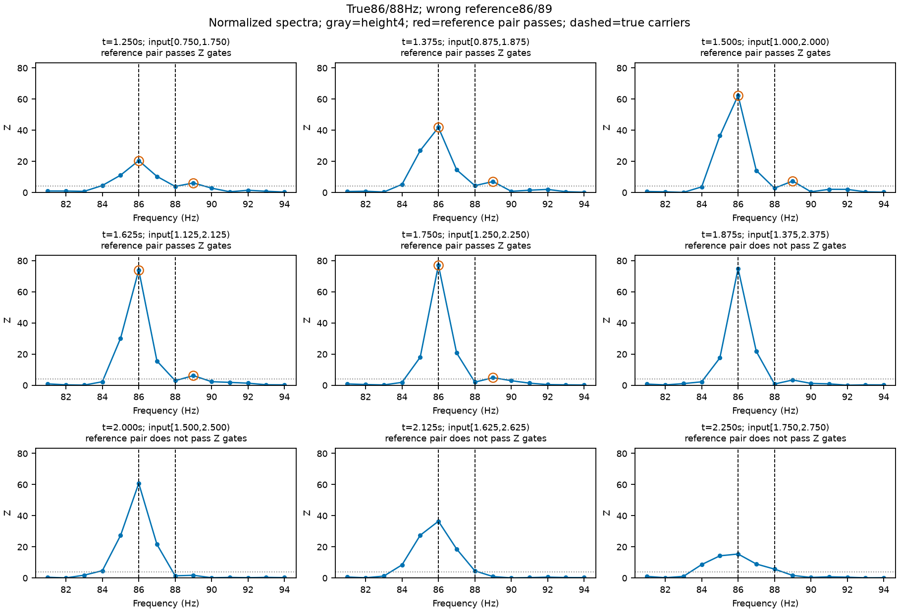
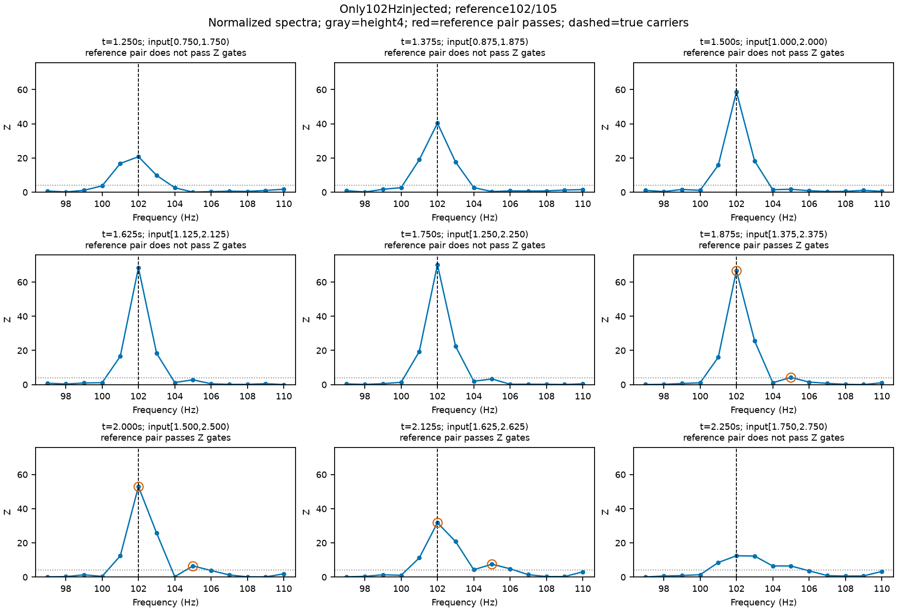

# Four examples: evolving local spectra and the meaning of nine central frames

28 November 2026. Saved-map visualization and arithmetic only. No waveform generation, new map calculation, detector change, threshold adjustment or new performance experiment. [Protocol](protocol.md), [verification](verification.json), [exact frame geometry](window_geometry.csv), [full local spectral samples](local_spectral_samples.csv), [frame metrics](frame_metrics.csv).

## Recording, injected tone support and analysis windows

Each input is4096samples at1024Hz:nominal record interval[0,4)s (last sampled time4095/1024s). Noise fills the record. Added finite tone(s) have1024samples at indices1280..2303,nominal support[1.25,2.25)s;the Tukey taper is zero at endpoints. The oscillation frequencies are constant; amplitude envelope,relative phase of unequal frequencies,noise and window weighting influence the observed spectra.

W1uses a1024-sample Hann window (1s),overlap896,hop128samples (0.125s),with no padding or boundary extension. Number of complete windows=1+(4096-1024)/128=25. Framej samples128j..128j+1023,nominal interval[0.125j,0.125j+1)s,label center0.5+0.125j. Thus all25centers span0.5..3.5s,not0..4. The protocol wording about displaying the four-second recording means all25available centers; it does not imply padded frames at the record edges.

Central9was the fixed retrospective evaluation choice:retain centers within[1.25,2.25]s,namelyj6..14inclusive. It is NOT9seconds or9independent recordings and does not mean each window is fully inside the signal.

| Frame | Center(s) | Input interval(s),end exclusive | Nominal overlap with added tone(s) |
| --- | ---: | --- | ---: |
| 6 | 1.25 | [0.75, 1.75) | 0.5s |
| 7 | 1.375 | [0.875, 1.875) | 0.625s |
| 8 | 1.5 | [1, 2) | 0.75s |
| 9 | 1.625 | [1.125, 2.125) | 0.875s |
| 10 | 1.75 | [1.25, 2.25) | 1s |
| 11 | 1.875 | [1.375, 2.375) | 0.875s |
| 12 | 2 | [1.5, 2.5) | 0.75s |
| 13 | 2.125 | [1.625, 2.625) | 0.625s |
| 14 | 2.25 | [1.75, 2.75) | 0.5s |

The9centers span1s,but their windows together cover[0.75,2.75)s,a2sinterval. Only center1.75has a window coinciding with the full nominal tone interval. Overlap duration is not weighted signal energy:Hann weights differ within each segment. Adjacent windows share87.5%of their input samples.

Fifteen of all25windows overlap the injected support at all (j3..17,centers0.875..2.625). The central9omit three earlier and three later partially overlapping windows. Full25frame maps remain visible in the overview. Normalization is estimated from the full4srecord,so out-of-pulse frames are not automatically independent clean calibration data.

## How to read the comparisons

Each row in the overview is one record. Left:raw STFT power on a10log10scale with arbitrary numerical reference1;not a physical PSD or dBFS. Right:log10normalized excess power Z. Color scales are shared across all four cases within each column. Raw display limits are pooled2nd/99.8thpercentiles,clipped for display only; exact raw/Zvalues are saved. Heatmap x is FRAME CENTER,not a single raw sample time. Horizontal dashed lines show true carriers for evaluation;vertical dotted lines show the selected central-center interval.

For every case there are TWO9-panel figures:normalized spectra and raw power. They preserve the entire local spectrum at each of the nine centers,with exact1Hzbin markers. Axis limits are identical across the9panels of a case,but differ between cases;do not compare pixel heights across different figures without reading the axes. Gray horizontal4line applies only to Z. Red circles mean the reference pair passes the previously fixed per-frame Zpeak/valley gates;they do not assert truth or define a raw-power detector. No interpolation-based frequency resolution is claimed.

## 1. A relatively persistent true pair

Case b00_two_0_0_1:true88/90Hz,equal amplitude,resultantSNR18. Exact88/90passes in5central frames at1.375,1.5,1.625,1.875,2.0s. Longest uninterrupted run3centers(1.375..1.625). This is the stronger illustrative persistence case,not continuous resolution through the entire pulse.

Both peaks grow and the whole intervening profile changes. At1.5s the valley is onlyabout8.9%of the weaker peak;at1.75s both heights are large (about30.09and29.02),but the valley ratio rises to0.940,so the pair fails the20%dip gate. At2.125s a neighboring bin outranks the90Hzbin,so a numerical valley between88/90alone is not enough:90must also be a local maximum. A real constant-frequency pair can merge or shift in this representation.

[Same nine raw-power spectra](stable_true_raw_nine_spectra.png)

## 2. A brief true pair under matched noise

Case b00_two_0_0_0.5:same noise,base carrier,global phase,onset andresultantSNR18as case1;weaker/stronger amplitude ratio0.5. Correct88/90passes only at1.375and1.5s,two adjacent centers. Later the weaker tone remains part of the input but appears as a shoulder or a shallowly separated bump. At1.625s its Zisabout11.73,above4,but valley ratio0.983fails;at1.75s the90Hzbin is no separate local maximum. Failure is not simply weak absolute peak height. Fixed resultant energy changes the individual component scaling,so this is not an intervention holding the stronger amplitude fixed.

[Same nine raw-power spectra](brief_true_raw_nine_spectra.png)

## 3. The persistent wrong86/89pair

Case b05_two_0_0_0.25:true86/88Hz,ratio0.25. Incorrect86/89passes fivecentral centers1.25..1.75s in a row (sixoverfullmap including1.125s). The main86Hzpeak rises strongly;89Hzremains a small isolated maximum aroundZ4.85..7.33whilethepairpasses. True88Hzis not the chosen second maximum. The false companion looks stable despite being1Hzaway from the weaker actual carrier. Local maxima at both reference frequencies also exist in the raw power in these qualifying frames;this example is not solely a peak invented by displaying normalized Z. That does not isolate noise,leakage and normalization contributions.

[Same nine raw-power spectra](stable_wrong_raw_nine_spectra.png)

## 4. A similar companion in a one-tone record

Case b09_one_0_0_1:only102Hzinjected,resultantSNR18. Apparent102/105passes at1.875,2.0,2.125s,threeconsecutive centers. The single strong102Hzpeak persists;theextra105Hzbump grows whilethemainpeakfalls. Its heights areabout4.16,6.49,7.51acrossthoseframes. There is no injected105Hztone. One record can therefore show a persistent weak companion and a clean-looking valley without containing a second sinusoidal component at that frequency.

This control was selected from the previous temporal study because it has a carrier-anchored3-frame near pair;it is illustrative,not a claim that every single tone behaves this way. Cases3/4use different noise/carrier bases from cases1/2,so visual differences between allfourcannot be assigned to one causal factor.

[Same nine raw-power spectra](single_companion_raw_nine_spectra.png)

## What is worth testing, and what is not established

The time evolution of a broad ridge,a true dip,a shoulder and an isolated weak bump differs within these examples. Persistence alone does not distinguish them. Neither do high amplitudes alone:a true pair can have two high neighboring bins and a filled valley. The wrong and single-tone examples share the broad visual pattern of a strong main peak plus a small apparently isolated companion;an actual unequal-amplitude pair can also be asymmetric. No visual rule inferred from these four cases is validated.

A candidate research question is whether full spectral shape and jointly evolving peak/valley structure carry information beyond peak count and run length. Relative phase for a2Hzdifference rotates through a full cycle every0.5s,while the Hann weighting and included noise samples also change;this is a reason to investigate morphology,not a proven sole cause of these observed changes. Any proposed feature must be tested on the full dataset and new independent controls with recalibration,not adopted from this gallery.

These examples demonstrate ambiguity of the CURRENTstatistics. They do not prove that the full waveform contains insufficient information for every method. Nor do they establish reliable two-source reconstruction or music stem separation. Honest outcome here:we have identified visual similarities and failure modes,not a reliable new discriminant.

## Checks and preservation

Geometry verified for all25windows,36reference-pair gate decisions checked against previous blind lists,local raw/Zsamples exported. Parent529andtemporal21artifact hashes unchanged. No waveform/map regeneration,exclusions,retuning or detector changes. Figures visually inspected. No O3,commit,push,mainmerge,releaseorZenodo. Local findings await review.
