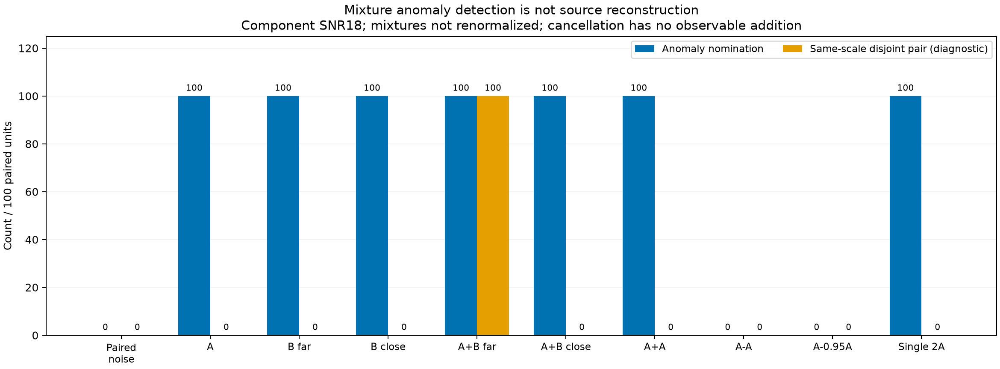
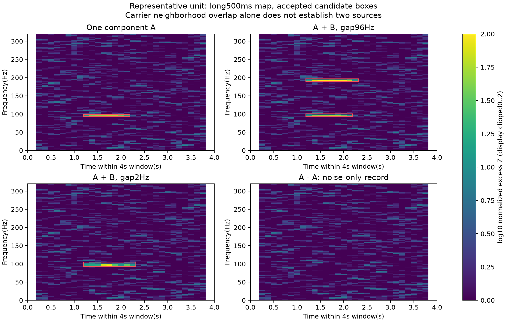

# Two oscillations: template-free anomaly detection in known mixtures

Run `20261127T183750Z_cc70b1c7`, sourcecc68b93. [Protocol](protocol.md), [independent checks](independent_verification.json), [counts](summary_counts.csv).

## Scientific question and input boundary

The unchanged three-scale detector receives a mixture waveform and independent noise calibration only. It never receives component frequency,time,phase,identity or a template. Ground-truth components serve the experimenter for evaluation. This is anomaly detection and candidate morphology, not source separation, reconstruction, source counting, physical identification or a newly discovered signal.

Template-free does not mean assumption-free: STFT scales, normalization, seed threshold, clustering, background and acceptance criteria are fixed. Unmodeled searches also exist in gravitational-wave research; see the official [LIGO O1 summary](https://ligo.org/science-summaries/O1GRB/). This is methodological context, not a claim of equivalent astrophysical sensitivity.

## Fixed pilot

Five fresh seeds22101..22105. Each has284calibration windows (85A/199B,FAP0.005),200held-out noise windows and20paired units,4s/1024Hz. Nine signal descriptions plus exact pairednoise perunit. Components are tapered one-second tones with carrier96..176Hz,far partner+96Hz,close partner+2Hz. Each component root-energySNR18; mixture is NOT renormalized. Colored noise and relative phase affect difficulty. Coherent resultantSNR36; nearcancellation0.9; distant mixture~25.456; close mixture24.19..26.66. These are not matched-resultantSNR or full frequency-resolution comparisons.

All cases share a noise base withinunit. Case/amplitude representations are not independent trials. Reported100/100is a bounded strong-signal control, not population recall. The detector has no component knowledge from the first case; no progressive knowledge-removal recovery method was implemented.

## Results

Independent held-out noise:2/1000nominations. Paired100noise controls:0nominations. These five calibration draws do not establish a universal0.5%FAP guarantee.

| Source description | Anomaly nominated / 100 | Same-scale disjoint far pair | Same-scale disjoint close pair | Resultant root-energy SNR |
| --- | ---: | ---: | ---: | --- |
| paired_noise | 0 | 0 | 0 | 0.000..0.000 |
| A_alone | 100 | 0 | 0 | 18.000..18.000 |
| B_far_alone | 100 | 0 | 0 | 18.000..18.000 |
| B_close_alone | 100 | 0 | 0 | 18.000..18.000 |
| A_plus_B_far | 100 | 100 | 0 | 25.456..25.456 |
| A_plus_B_close | 100 | 0 | 0 | 24.190..26.663 |
| A_plus_A | 100 | 0 | 0 | 36.000..36.000 |
| exact_cancel | 0 | 0 | 0 | 0.000..0.000 |
| near_cancel | 0 | 0 | 0 | 0.900..0.900 |
| equivalent_single | 100 | 0 | 0 | 36.000..36.000 |

The two-structure criterion requires TWOacceptedcandidates in the SAMEscale with disjoint frequency boxes, matching evaluation-only carrier neighborhoods and the event time. Different scale IDs alone do not count as different structures. It is not reconstruction of two sources or a calibrated source-count estimator.

Far mixtures satisfy this criterion100/100; close mixtures are anomalous100/100but satisfy it0/100. This is an observed limitation of this configuration at these two fixed gaps and durations. It is NOT a measured universal resolution threshold, proof that2Hz can never be resolved, or a complete boundary between96and2Hz. No gap/phase/window-length sweep was performed.

## What is unobservable or ambiguous

Exact A-A has zero residual and is byte-identical to the paired noise. Its full core scores,p-values,candidates and per-scale outputs are identical. This is NO_OBSERVABLE_ADDITION, not a missed observable signal or an abstention. Nearcancellation leaves a weakSNR0.9residual and is not nominated in this sample; that is a sensitivity result for a remaining signal, not exact non-identifiability.

A+A and a single2A are also byte-identical and produce exactly identical detector outputs. Their distinct latent source descriptions cannot be chosen from this one record without additional assumptions. This is a constructed algebraic counterexample, not a newly discovered theorem or evidence about astrophysical sources.

Carrier-band annotations are deliberately loose and MUST NOT be used as source counts. Aalone intersects both AandBclose diagnostic bands100/100because the neighborhoods overlap; onlyonecomponentwasadded. Some broad candidate boxes intersect a far carrier neighborhood even when no far component exists (e.g. coherentA+A15/100). These are bounding-box associations, not newly generated physical harmonics or recovered sources. Preserve the actual candidates and conservative disjoint-structure criterion.

Finite tapered tones have spectral leakage, and the plotted frequency bands are carrier neighborhoods, not exact spectral support. Differences across carrier frequencies also reflect the colored noise and normalization; do not attribute every score change to frequency separation alone.

## Verification and scope

Independent checks pass5calibrations,2000measurementrecords,2565candidate records and3420regenerated inputs;75directuncachedrawchecks. ReconstructAstatistics,Bnull/threshold,p/strictdecisions,per-scale maxima,candidate standardization/bounds,bandintersections,morphology,energy/cross-term identities and all identical-input/core-output controls. Streamhashseparation and frozen/source/dependencyhashes preserved. These are scoped checks,notpytestpasses or a proof of scientific validity.

No measurement/preparation failure, interrupted run, excluded seed, detector tuning or experiment rerun. No production/app/test edits, monitor/adaptive/Union/veto changes, O3/data/manifest/network/real-waveform access by the experiment. Public LIGO O1context was read separately; no scientific data downloaded. Previous studies and current unrelated drafts remain untouched. New results local; no commit/push/release/Zenodo.

Representative firstseed22101/unit0,long500msscale. Display crops0..320Hz and clips log10Zto0..2 for readability; detection uses its unchanged full analysis. Red boxes are acceptedlong-scale candidates, not outlines of true sources. Original map values retained in JSON.

## Decision

The instrument can nominate unfamiliar mixture structure without exact templates in these controls. Detection, distinct candidate morphology and unique source reconstruction are different questions. Continue anomaly research with explicit noise controls and preserved ambiguity; no source separator, mathematical universal boundary or detector modification is adopted here.
