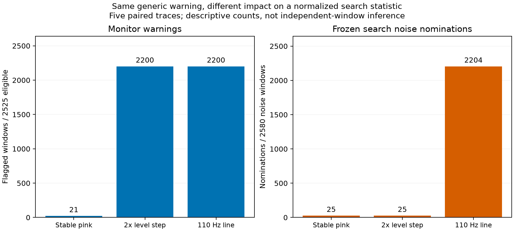
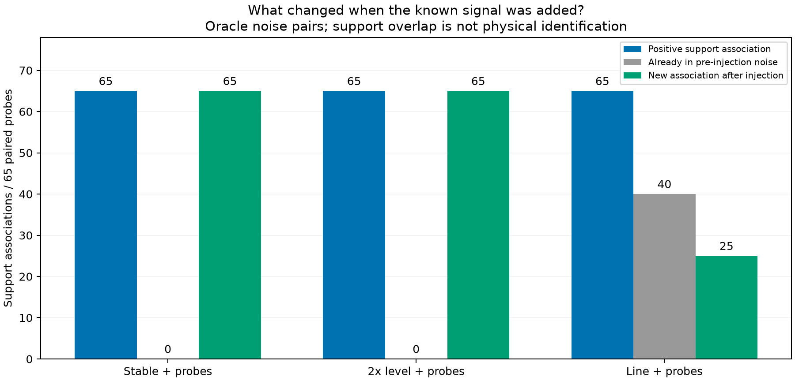

# Corrected cadence and warning-impact control

Run `20261127T175353Z_5cad334d`, sourcecc68b93. [Pre-run protocol](protocol.md), [numerical verification](independent_verification.json), [independent paired-impact analysis](independent_impact_analysis.json), [counts](summary_counts.csv).

## Fixed design and correction

Five FRESH seeds21101..21105;800continuous four-second observations per seed, eight paired cases, unchanged default causal BackgroundRegimeMonitor and frozen core calibration (85A/199B,FAP0.005). No automatic reference update, detector gating, source selection or threshold tuning. The5seeds are replication units; windows/cases are dependent and paired.

Repeated injections use the64-slot grid288..792every8windows. Sparse injections use every fifth slot starting at grid position2:13slots304..784. Family is global-grid parity, so both schedules alternate AND every shared probe has identical family,waveform,noise,SNR18,support and core output. The old inconsistent study is retained; new counts are not improvements relative to its different seeds/schedule.

The monitor has11warmup target windows; search decisions remain available. Warnings annotate the same frozen measurement records and never suppress candidates. The2400sage policy and all previous adaptive machinery are absent from this study.

## All cases: descriptive counts

| Case | Warnings / monitor-eligible windows | Episodes | Search noise alarms / noise windows | Signal support associations | Hypothetical gate losses |
| --- | ---: | ---: | ---: | ---: | ---: |
| stable | 21/2525 | 9 | 25/2580 | 0/0 | 0 |
| level_step | 2200/2525 | 5 | 25/2580 | 0/0 | 0 |
| spectral_line | 2200/2525 | 5 | 2204/2580 | 0/0 | 0 |
| sparse_transients | 18/2525 | 8 | 24/2515 | 65/65 | 2 |
| repeated_transients | 26/2525 | 13 | 24/2260 | 315/320 | 4 |
| persistent_signal | 2200/2525 | 5 | 4/380 | 2200/2200 | 2200 |
| step_with_probes | 2200/2525 | 5 | 24/2515 | 65/65 | 55 |
| line_with_probes | 2200/2525 | 5 | 2149/2515 | 65/65 | 55 |

Zero-denominator signal groups are not efficiency estimates. Warning windows within an episode are not independent alarms; persistent-tone observations represent one sustained source per seed, not hundreds of independent events. Actual search availability is unchanged in every case. No formal superiority/FAP-confidence inference from these five paired sequences.

## A. Corrected shared-probe cadence control

All65shared probe pairs have identical input and core outputs. Warning flags differ on1shared positions. Of65core support associations, hypothetical warning gating removes2in the sparse context and3in the repeated context. These differences, if present, arise from monitor history with the same current observation, not a changed search statistic. A null result is retained; it does not prove history never matters.

Full additional repeated-probe counts are in the table; do not compare raw totals65vs320as if dose/denominators were equal.

## B. Changed measurements versus search impact

Across5160paired target comparisons (stable->level_step and sparse->step_with_probes), max search-score difference is0.0; nomination disagreements0. The same factor-two gain step can trigger persistent warnings while leaving this locally normalized search statistic unchanged. This is a verified property of this constructed gain intervention, not a proof for arbitrary instrument response changes.

In this run the stationary and factor-two gain cases each produce25/2580noise nominations (about0.969%) at nominalFAP0.005. Identical paired behavior is NOT evidence that the nominal0.5% operating rate has been established. With five shared calibration draws and correlated windows, no pooledIID significance calculation or general FAP conclusion is justified here. This pilot did not diagnose the source of the pooled-rate difference.

The line profile can instead strongly increase stale-calibration noise nominations. Similar generic warning flags therefore do not quantify the same effect on detector reliability. No automatic harmless/dangerous warning classifier was trained here; effects are measured with paired synthetic controls unavailable in ordinary deployment.

## C. Did the injected signal add a new association?

For every positive probe, score the exact pre-injection noise candidate list against the SAME truth support after detection. The algorithm never sees this support. Counts are not physical waveform identification.

| Positive case | Probe pairs | Positive association | Noise already associated | New association | Lost association | Positive-only nomination |
| --- | ---: | ---: | ---: | ---: | ---: | ---: |
| sparse_transients | 65 | 65 | 0 | 65 | 0 | 64 |
| step_with_probes | 65 | 65 | 0 | 65 | 0 | 64 |
| line_with_probes | 65 | 65 | 40 | 25 | 0 | 10 |

These columns are not a disjoint partition: noise-already includes any lost association. A positive candidate also present in noise is insufficient evidence that the injection was identified. This is an oracle diagnostic, not a new detector acceptance rule.

## D. Fixed future noise after warning episodes

For each onset, observe the NEXT12windows, excluding the onset itself. Overlapping ranges are unioned and end-of-run ranges truncated. This is retrospective descriptive association, not validated prediction or causation.

| Noise-only case | Unioned future alarms / windows | Actual exposure(s) |
| --- | ---: | ---: |
| stable | 2/75 | 300.0 |
| level_step | 0/60 | 240.0 |
| spectral_line | 60/60 | 240.0 |

An empty future set has unavailable conditional rate(null), not zero. Do not credit a warning as successful reliability control merely because it overlaps a known generated change. No warning gating was performed.

## Ambiguity and limits

Spectral-line and desired-persistent-tone inputs, core outputs and monitor warnings remain exactly identical; only evaluation labels differ. Warning cannot identify physical noise origin or justify absorbing a persistent signal into background. No real waveform, astrophysical novelty, GW170814 causal explanation or real-instrument lifetime claim.

This corrected pilot has two chosen noise changes,SNR18families,five jointFFTcolored seed traces and one fixed observation horizon. Noise windows are notIID; source-calibration variation remains. Equal nominalFAP is not equal achievedFAR. Any future automatic impact policy needs a new frozen rule, application budget and independent validation, retaining false alerts, missed/abstained signals and persistent-signal ambiguity.

## Verification and preservation

Numerical checks pass5reference models,5calibrations,20640monitor/search/sidecar records each,83536candidate records,32000regenerated input records,135manualNumPyFFTfeatures and120prefix comparisons. KSinteger-path oracle checks121200comparisons with maxBonferroniperror9.99e-16. Shared65probeidentity and195positive/noise pairs independently reconstructed. Five future-exposure fixtures test duplicates,overlap,empty andtruncation. These are scoped checks,notpytestpasses orproof ofstatistical validity.

Initial/source/reference/calibration hashes and all search/candidate payloads preserved. Old variants untouched. No excluded cases, threshold/seed retuning, production/app/test edits, O3/data/manifest/network/realwaveform access, publication or adoption. No measurements rerun to improve a result. Retain any implementation/error records separately from scientific outcomes.

## Decision

Use the monitor as a provisional annotation of changed measurements. Do not equate every warning with invalid detector calibration or every support-associated positive with identification of the added signal. No new detector or automatic recalibration policy is adopted by this study. L09/L10 remain unresolved.
